<div align="center">

**English** | [繁體中文](README.md) | [简体中文](README.zh-CN.md) | [日本語](README.ja.md)

# Video Subtitle Translator

**Turn a long English talk into well-timed bilingual subtitles and a key-points summary, on your own PC and your own GPU.**


</div>

Pick an English talk video that has no subtitles. The app recognizes the speech, cuts it into subtitle lines, translates them, writes a summary with chapters, and plays the video with the subtitles under it. Every step runs on your machine. On an RTX 4090 a 38-minute talk takes about 5 to 6 minutes.

## Features

### The whole pipeline runs locally

Import a video and the window shows the seven steps as they happen: audio extraction, voice detection, speech recognition, sentence splitting, translation, subtitle output and the summary. Every step is cached in the project folder. Run it again and finished steps are skipped. Stop it halfway and it resumes at the step it stopped on. Change the translation model and only translation, export and the summary run again.

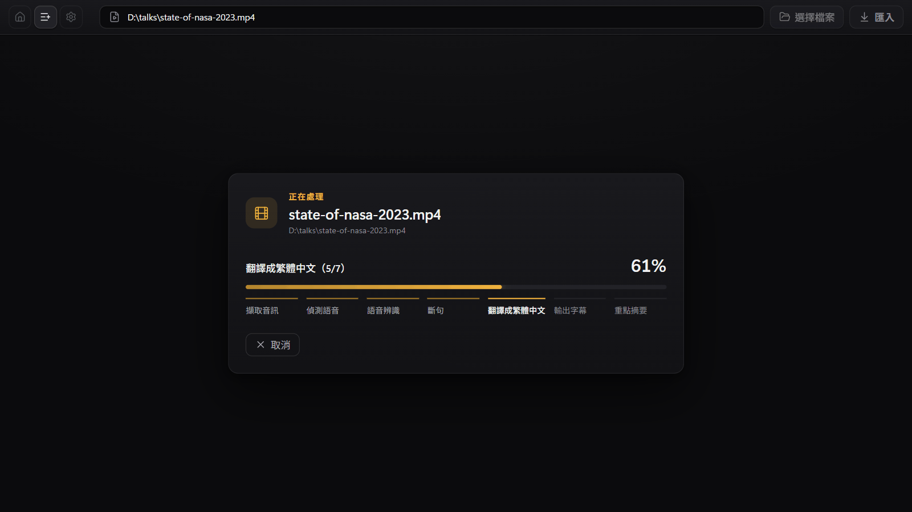

### Bilingual subtitles under the video

The subtitles sit under the video, not on top of it, and they are separate from the video file. Switch between English only, translation only, or both. The video never changes size when you switch, and the cue list on the right follows playback. Click a cue to jump to it.

| English only | Translation only | Both |
| --- | --- | --- |
| 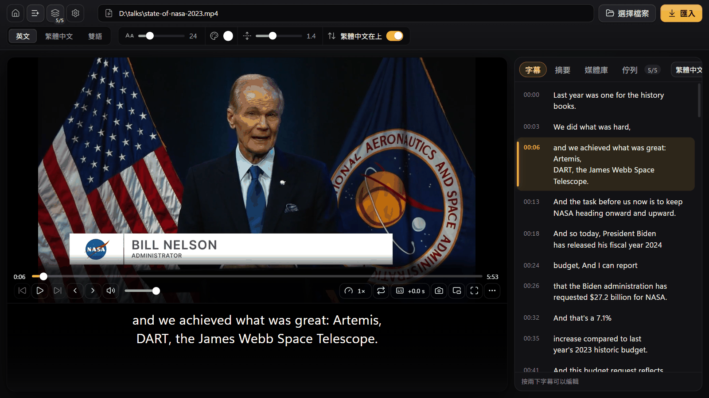 | 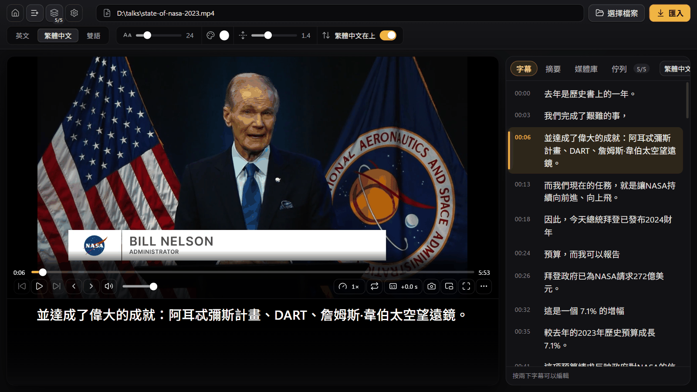 | 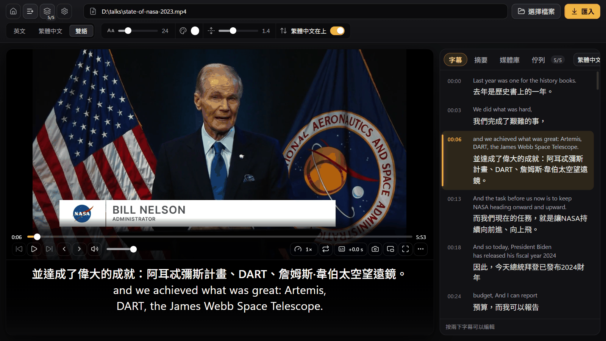 |

### Fix a line right in the list

Double-click a cue, or press F2 on it, to edit its time and text. Enter saves, Esc cancels, and Ctrl+Z undoes. A bad edit is refused with the reason shown in the row: overlapping the next cue, ending before it starts, running longer than 7 seconds, empty text, or a malformed time. The English line is the recognition result and stays read-only, because the translations and the summary are built from it.

An edited cue is never overwritten silently. If you translate the same project again from the command line or the API, your edits are laid back over the new translation, and the run reports how many were kept and how many no longer fit.

| A refused edit | A saved edit |
| --- | --- |
| 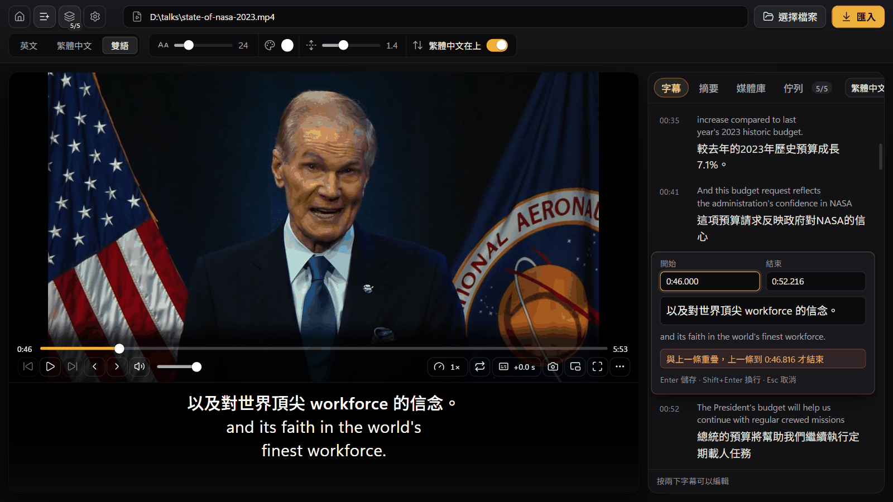 | 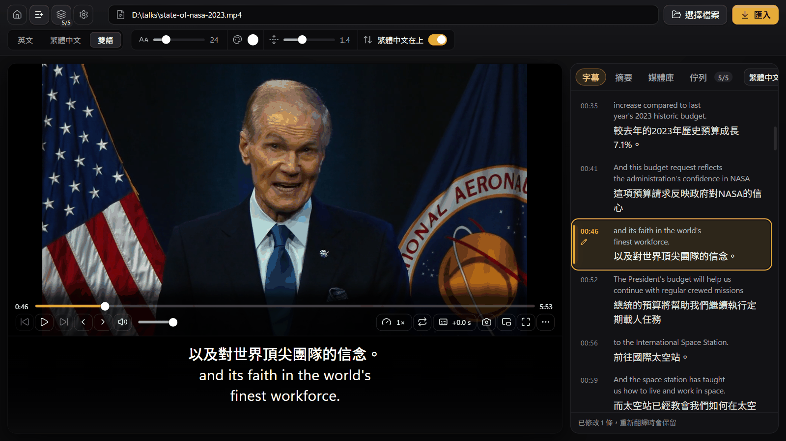 |

### A summary with chapters

The summary tab shows a one-line gist, chapters with timestamps, key points and takeaways. Click a chapter's timestamp and the video jumps there.

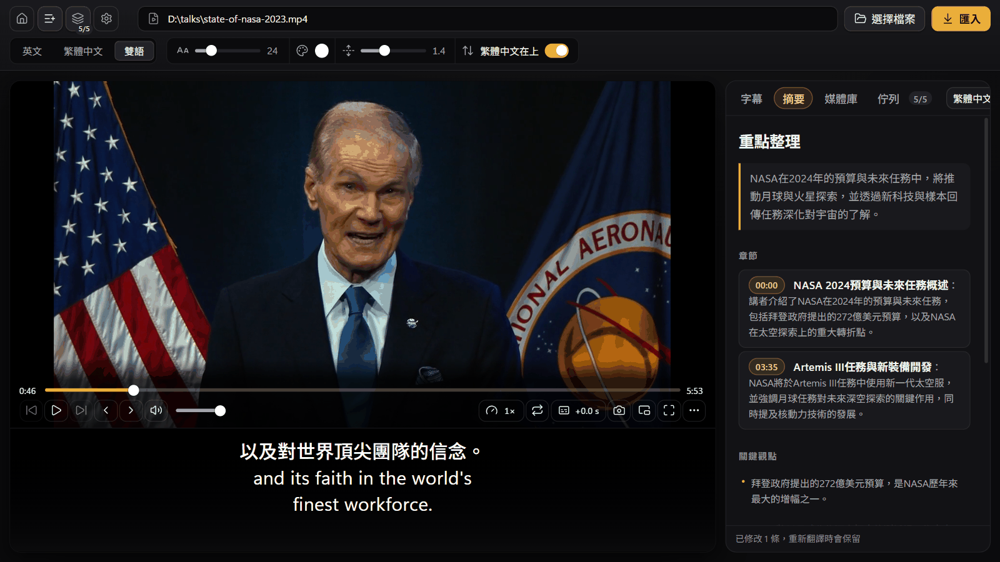

### A real player with a library

Every finished talk sits in a library with a thumbnail, its languages and a resume bar. The play queue steps from one talk to the next, and a talk reopens where you stopped. The controls sit over the bottom of the picture, so the subtitles stay below it. You get play, previous and next talk, previous and next line, volume, a seek bar, speed from 0.5 to 2, an A-B loop, a subtitle offset, a screenshot of the current frame, picture in picture and fullscreen. Frame step and the other keys are on the keyboard, and `?` lists them all. Drop a video on the window to import it.

The offset does not rewrite the cues. It is applied when you play and when you export, so you can take it back.

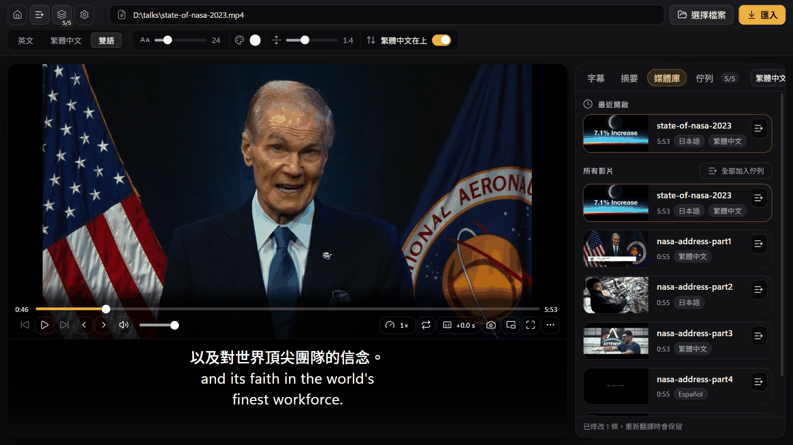

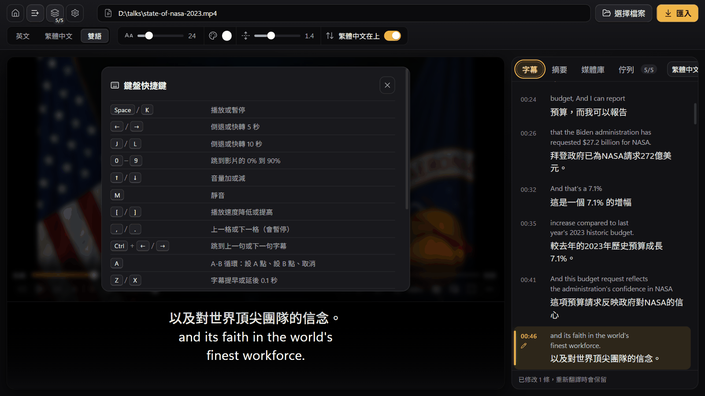

### Export

Export SRT (English, translation or bilingual), ASS, VTT, and the summary as Markdown. Subtitle files are plain UTF-8 and open in any player. You can also burn the subtitles into an MP4, for the whole video or for 30 seconds from where you are.

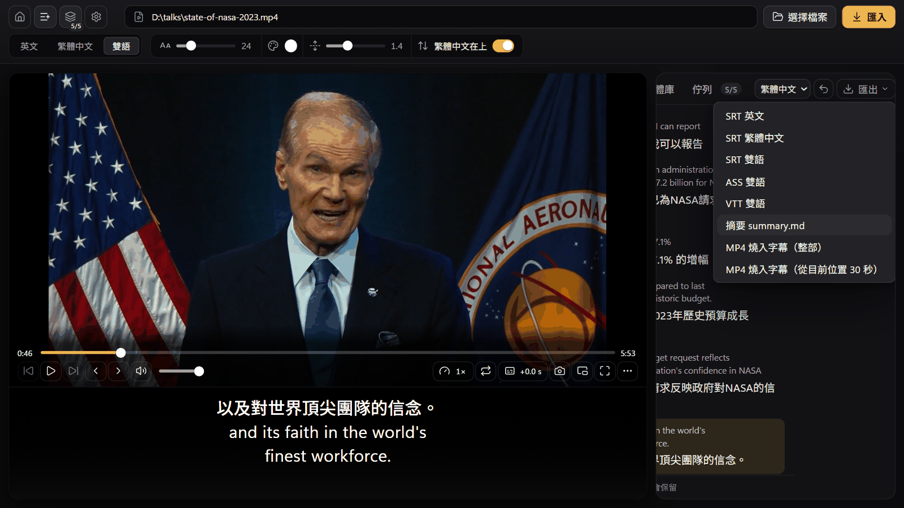

### Batch queue

Queue many videos and let them run, overnight if you like. Add several files at once, pick a folder, or drop files on the window, and choose a target language for each video. The panel shows each video's state, its current step and an estimate of the time left. Pause the queue or one video, cancel, retry, remove, or drag a row to reorder. A finished row opens in the player. When the queue ends you get a notice in the window and a Windows notification. The app can also put the PC to sleep or shut it down, but that is off by default and needs your confirmation first.

| Adding videos, one language each | A queue at work |
| --- | --- |
| 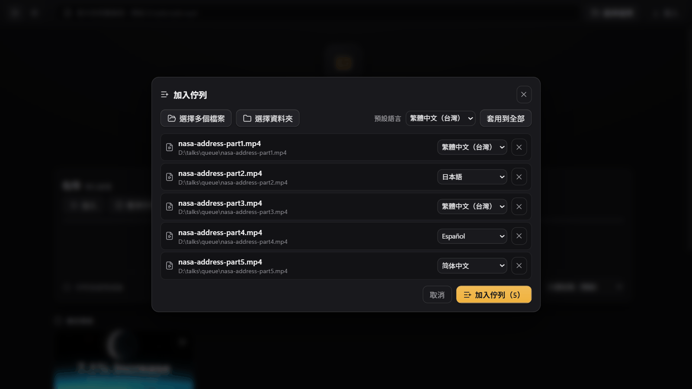 | 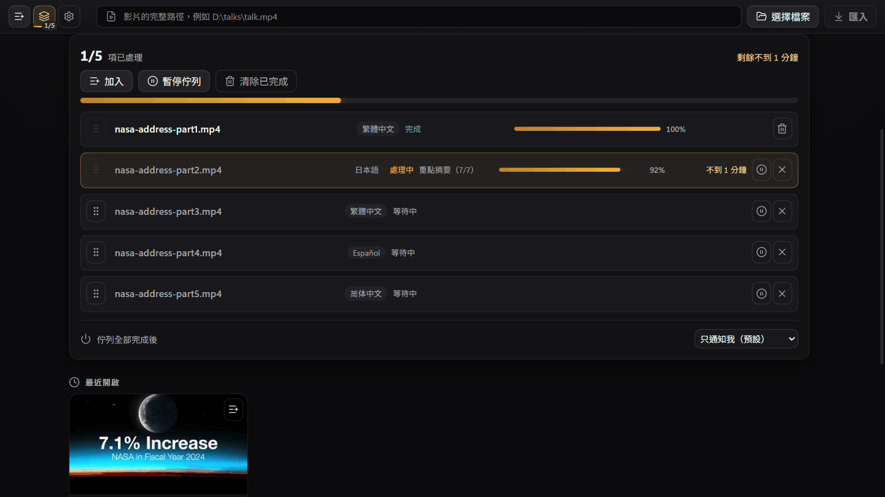 |

### Settings and first-run setup

The first time you start the app with no speech or translation model installed, a setup wizard detects your GPU, VRAM, driver, RAM and free disk. It recommends one of three profiles (24 GB GPU, 8 GB GPU, CPU only), lists every download with its size and license, downloads with progress and a cancel button, and ends with a self-test. If the GPU test fails, it falls back to the CPU and says why.

The gear button opens the settings page. There you can verify, repair, re-download or delete each model and runtime, check for updates, move the models folder, switch the profile at any time, choose the language model (built in, Ollama, or a cloud model after you agree that the text leaves your PC), and read the license of every component.

| First-run wizard | Downloading, with progress |
| --- | --- |
| 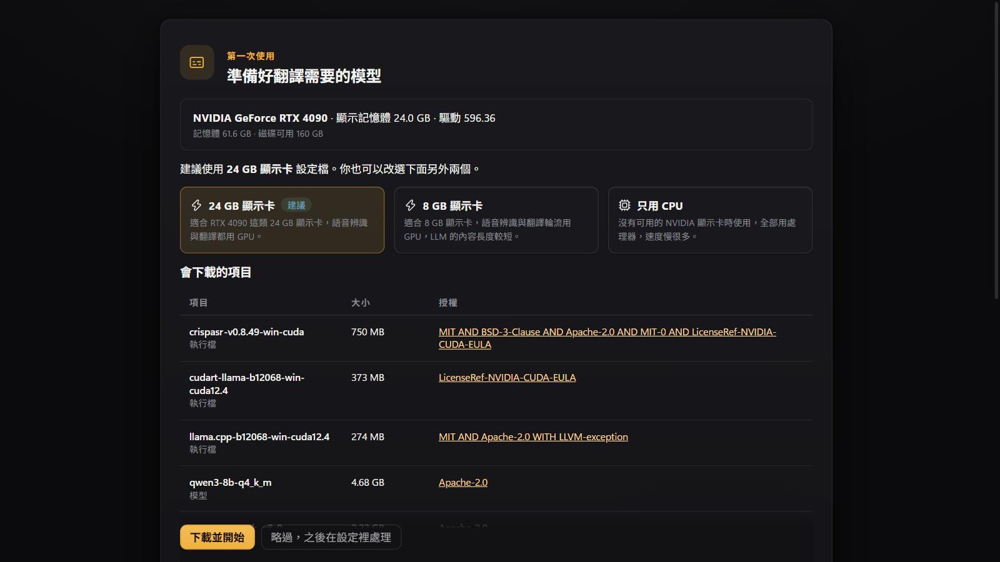 | 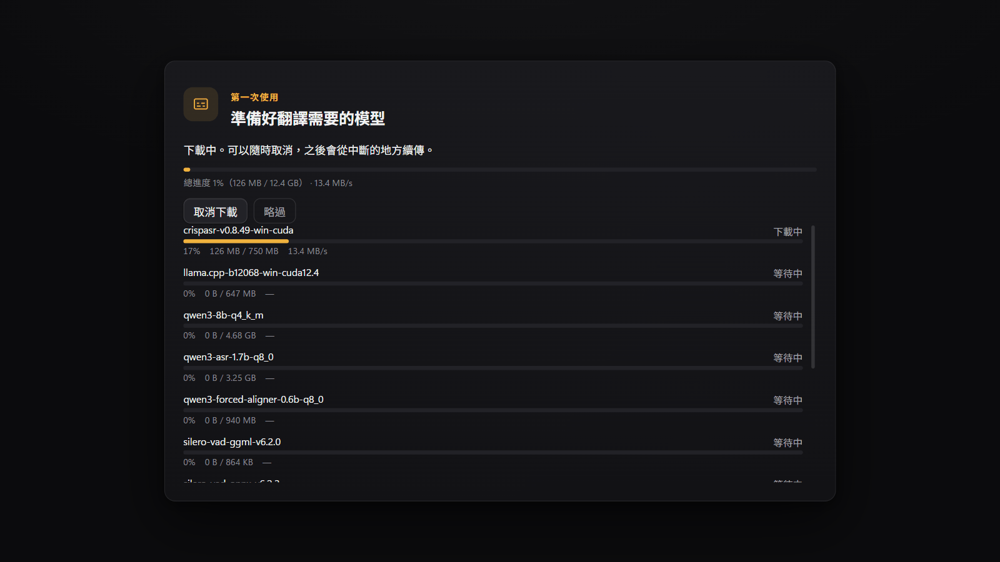 |

| Models and runtimes | Hardware and profile |
| --- | --- |
| 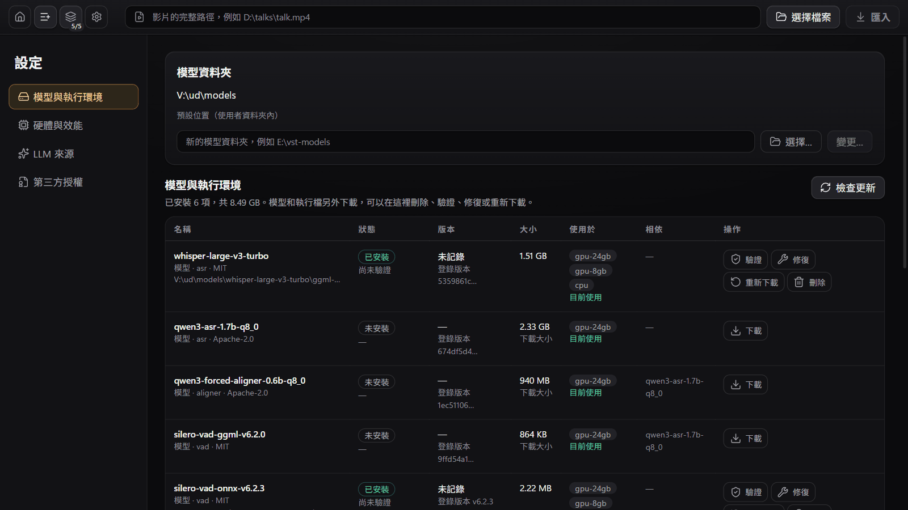 | 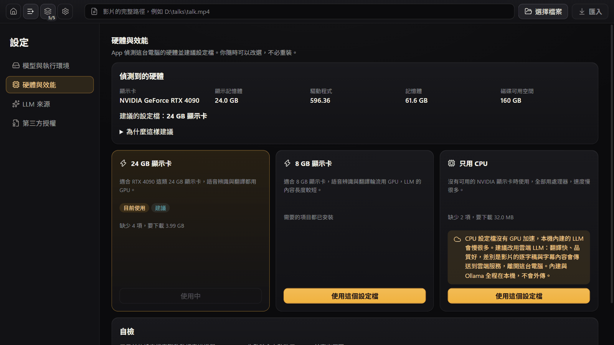 |

### Thirteen target languages

Traditional Chinese (Taiwan) is the default. A project can hold several languages side by side, and a selector in the cue column switches between them. Each language has its own prompt and its own script check, so a reply in the wrong writing system is rejected and asked again. See [Target languages](#target-languages).

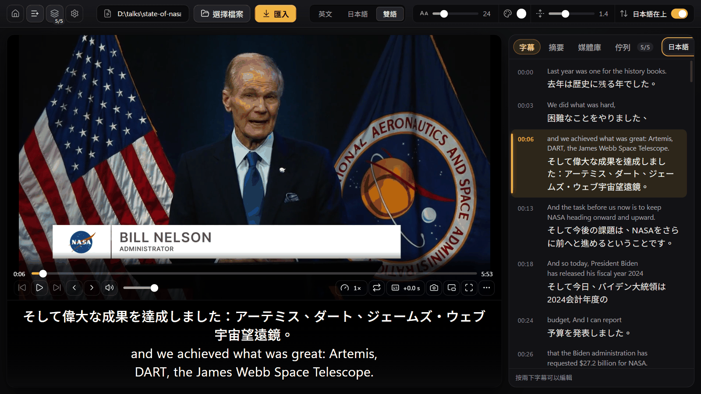

### More

- Translation uses a fixed seed. Two cold runs of the same talk gave byte-identical subtitle files.
- Closing the window stops the backend and every speech or language process under it.
- Everything the window does is also available from the command line and a token-guarded local API.

## Demo video


[Download the video](docs/media/demo.mp4). About a minute and a half: import, progress, playback, switching modes, the shortcut list, an edit, a summary chapter jump, a second language and export, then the batch queue, the settings page and the first-run wizard. The progress and the queue run are sped up.

## In development

These are not in the app yet.

- **An installer.** There is no installer and no download, so you build the app from source. See [Install and run from source](#install-and-run-from-source).
- **Choosing the target language for a single import.** The import box imports into Traditional Chinese (Taiwan). Other languages are chosen per video in the batch queue, or with `--lang` on the command line.
- **Deleting a saved cloud key.** The window can save a key and replace it, but not remove it.

## System requirements

This project is developed and measured on one machine: Windows 11, an NVIDIA RTX 4090 with 24 GB of VRAM, and 64 GB of RAM. Other setups are not tested.

- Windows 64-bit. Windows 11 is the tested system.
- An NVIDIA GPU and a current NVIDIA driver. You do not need to install the CUDA Toolkit.
- The default profile expects at least 16 GB of VRAM. The backend also has an 8 GB profile (from 7 GB of VRAM) and a CPU-only profile. Neither has been run on matching hardware yet.
- Disk for the runtimes and models: about 12 GB for the default profile, which also fetches a fallback speech engine, and about 8 GB for the 8 GB profile. Add room for project folders.
- ffmpeg on `PATH`, or its folder in `VST_FFMPEG_DIR`.

## Install and run from source

**The app is not packaged yet.** There is no installer or download, so you build it yourself. These steps are for developers.

You need Python 3.11 or newer with [uv](https://docs.astral.sh/uv/), Node.js with npm, Rust with the MSVC toolchain (the Tauri 2 prerequisites), and ffmpeg.

```powershell
git clone https://cggitlab.chinesegamer.net/abcd1997/speech-subtitle-ai.git
cd speech-subtitle-ai

uv sync                                   # backend environment, .venv
npm --prefix app ci                       # frontend dependencies
cd app; npx tauri build --no-bundle; cd ..   # builds app/src-tauri/target/release/video-subtitle-translator.exe
```

The speech and language models and their runtimes are not part of the repository. Start `app/src-tauri/target/release/video-subtitle-translator.exe`. When no model is installed, the setup wizard offers to download the ones your hardware needs from their public hosts. That takes a network connection and, for the default profile, about 12 GB of disk. You can skip it and download later from the settings page.

Files land in `%LOCALAPPDATA%\video-subtitle-translator` (set `VST_USER_DATA` to use another folder). The window starts the Python backend from `.venv` and stops it when you close the window.

## Usage

### In the window

1. Paste the full path of a video or press "Choose file", then press "Import". The progress screen shows the current step. To process many videos, press "Add", or drop several files on the window, and give each its own language.
2. When it finishes you land in the player. A talk you processed before opens straight in the player, where you left off, and the library tab lists the others.
3. Use the mode switch for English only, translation only or both. The size, color and line spacing of the subtitles are in the toolbar.
4. Double-click a subtitle to edit it. Open the summary tab and click a chapter time to jump, and save files from the export menu. Press `?` for every keyboard shortcut.
5. The gear button opens the settings page, for models, the hardware profile and the language model.

The window plays what the system's WebView2 can decode. H.264 with AAC in MP4 is the safe choice. If a video does not play, the window says so and asks for an H.264/AAC MP4 copy.

### From the command line

```powershell
uv run python -m backend.cli talk.mp4 --lang ja
```

This writes `talk.vst\` next to the video with `en.srt`, `ja.srt`, `bilingual.en-ja.ass`, `summary.ja.md` and `project.json`. Running the command again does nothing because every step is cached. `--lang` takes any code from [Target languages](#target-languages), and `--help` lists every option. A project keeps one translation per language.

## Privacy

Speech recognition and translation run on your machine by default. The video, the audio and the transcript never leave it, and the local API listens on `127.0.0.1` only, behind a per-run token.

A cloud language model is optional and off by default. If you choose it, the backend refuses to save the setting until you explicitly agree, because the text of your video leaves your PC. The API key is encrypted with Windows DPAPI, can be written but not read back through the API, and does not appear in config files or logs. You choose it on the settings page, where the window asks for your agreement first.

Downloading the models and runtimes is the only time the app needs the network, apart from the optional cloud model.

## Target languages

| Code | Language | Note |
| --- | --- | --- |
| zh-TW | Traditional Chinese (Taiwan) | Default |
| zh-CN | Simplified Chinese | |
| ja | Japanese | |
| ko | Korean | Experimental |
| es | Spanish | |
| fr | French | |
| de | German | |
| pt | Portuguese | |
| it | Italian | |
| ru | Russian | |
| vi | Vietnamese | |
| th | Thai | Experimental |
| id | Indonesian | |

Quality differs by language. On the 38-minute talk, a back-translation check scored Spanish, Simplified Chinese and German on a par with Traditional Chinese, Japanese a little below, and Korean clearly lower, with wrong names and meanings in some lines. Korean and Thai are marked experimental for that reason. Of the thirteen, six were run end to end on a real talk (zh-TW, zh-CN, ja, ko, es, de). The others are covered by tests only.

## Media credits

The screenshots and the demo video were made with a clip of the NASA "State of NASA" address by NASA Administrator Bill Nelson, 9 March 2023 ([NASA Image and Video Library](https://images.nasa.gov/details/2023%20%E2%80%98State%20of%20NASA%E2%80%99%20Address%20from%20Administrator%20Bill%20Nelson)). The clip runs from 1:14 to 7:07 of the original. NASA media is generally not subject to copyright in the United States, [NASA's media usage guidelines](https://www.nasa.gov/nasa-brand-center/images-and-media/) apply, and NASA does not endorse this project. The clip itself is not in this repository. The subtitles and the summary in the images were produced by this app.

## License

[GNU Affero General Public License v3.0 or later](LICENSE) (AGPL-3.0-or-later). Third-party notices are in [THIRD-PARTY-NOTICES.md](THIRD-PARTY-NOTICES.md).
