<div align="center">

[English](README.md) | [繁體中文](README.zh-TW.md) | [简体中文](README.zh-CN.md) | **日本語**

# Video Subtitle Translator

**英語または日本語の長い講演を、自分のPCとGPUだけで、タイミングの合ったバイリンガル字幕と要点まとめにします。**


</div>

字幕のない英語、日本語、または日本語と英語が混ざった講演動画を選ぶと、音声認識、字幕の分割、翻訳、章立て付きの要約までを行い、動画の下に字幕を出して再生できます。処理はすべて手元のPCで動きます。RTX 4090 なら、38分の講演が約5〜6分で終わります。

## 特長

### パイプライン全体がローカルで動く

動画を取り込むと、音声の抽出、音声区間の検出、音声認識、文の分割、翻訳、字幕の出力、要約という7つのステップが画面に順に表示されます。各ステップの結果はプロジェクトフォルダに保存されます。もう一度実行すると、終わったステップは飛ばされます。途中で止めても、止まったステップから再開します。翻訳モデルを変えたときに再実行されるのは、翻訳、出力、要約だけです。

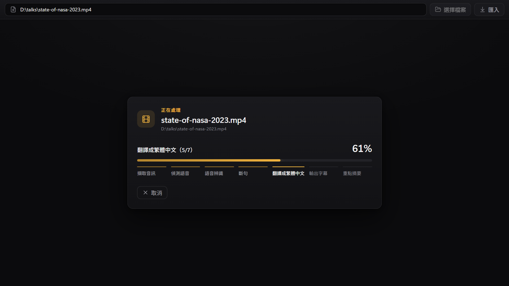

### 動画の下に出るバイリンガル字幕

字幕は動画に重ならず、下の専用エリアに表示されます。動画ファイルに焼き込まれることもありません。原文のみ、訳文のみ、両方の3つの表示を切り替えられ、切り替えても動画の大きさは変わりません。右側のリストは再生位置に合わせて動き、字幕をクリックするとその位置にジャンプします。

| 原文のみ | 訳文のみ | 両方 |
| --- | --- | --- |
| 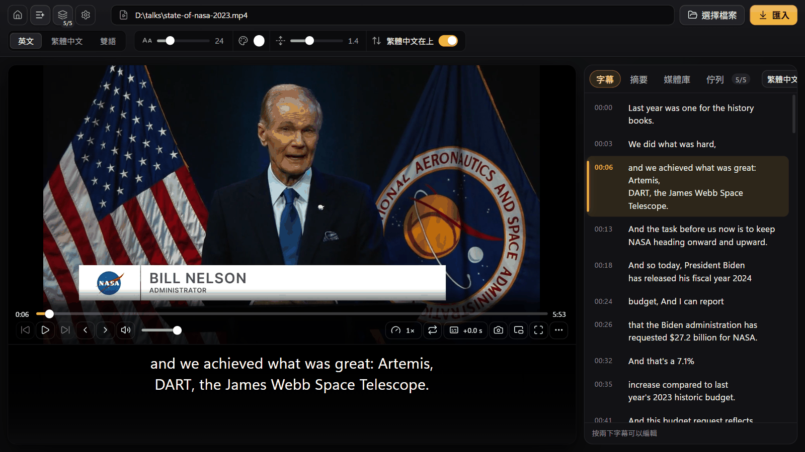 | 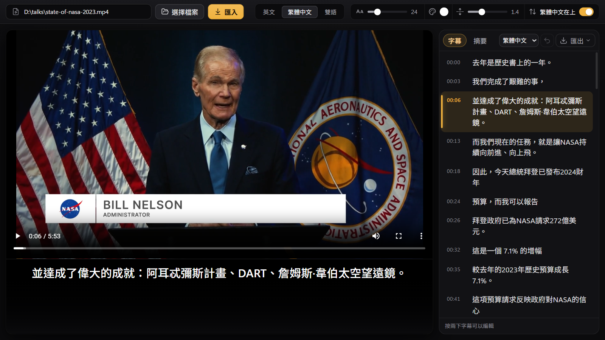 | 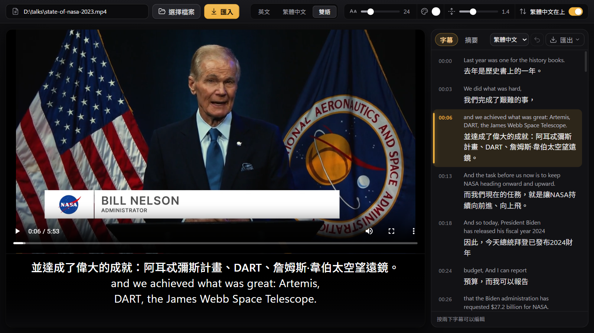 |

### リストの上で字幕を直す

字幕をダブルクリックするか、選んで F2 を押すと、時刻とテキストを編集できます。Enter で保存、Esc で取り消し、Ctrl+Z で元に戻します。おかしな修正は、理由がその行に表示されて拒否されます。次の字幕と重なる、終了が開始より前、7秒を超える、テキストが空、時刻の書式が違う、のいずれかです。英語の行は認識結果なので読み取り専用です。各言語の訳文と要約がそこから作られるためです。

手で直した字幕が黙って上書きされることはありません。同じプロジェクトをコマンドラインやAPIからもう一度翻訳すると、直した内容が新しい訳文の上に重ねて戻され、実行レポートに保持できた件数と合わなくなった件数が出ます。

| 拒否された修正 | 保存された修正 |
| --- | --- |
| 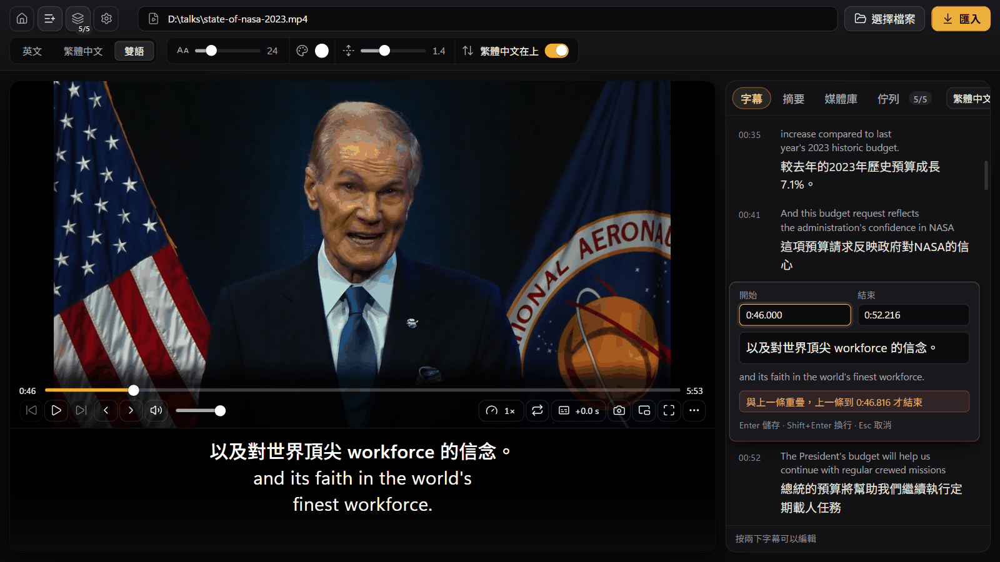 | 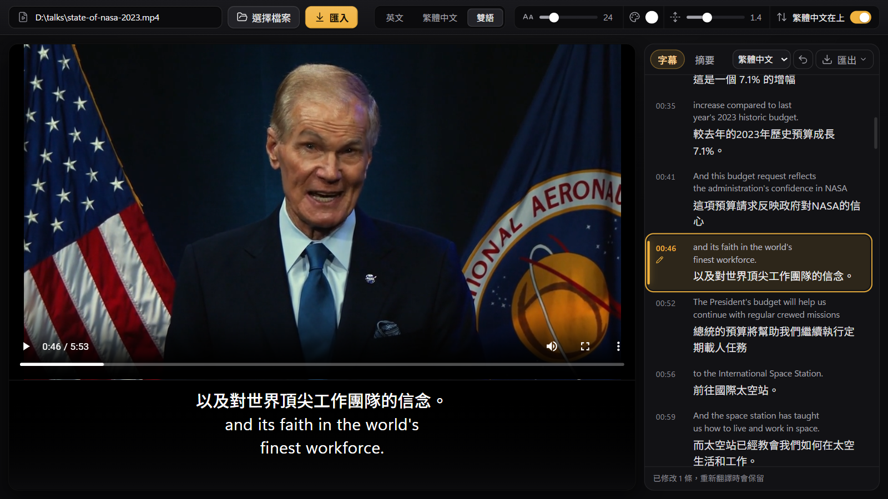 |

### 章立て付きの要約

要約タブには、ひとことでの概要、時刻付きの章、重要なポイント、結論が並びます。章の時刻をクリックすると、動画がその秒数へジャンプします。

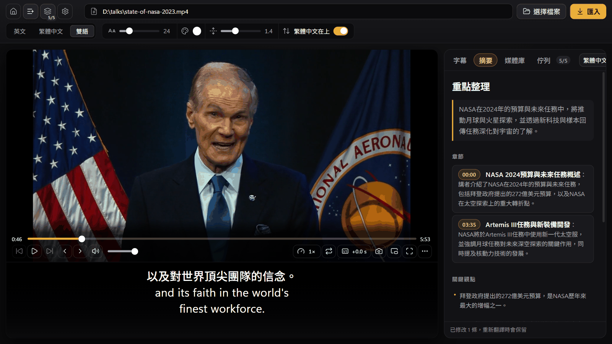

### ライブラリ付きの本格的なプレーヤー

処理が終わった講演は、サムネイル、言語のタグ、再開位置のバーと一緒にライブラリに並びます。再生キューは1本ずつ順に再生し、次に開いたときは止めた場所から始まります。操作バーは映像の下端に重なるので、字幕は映像の下に出たままです。再生、前後の動画、前後の字幕、音量、シークバー、0.5倍から2倍の速度、A-Bリピート、字幕のずらし、現在のフレームのスクリーンショット、ピクチャインピクチャ、全画面を使えます。コマ送りなどのキーはキーボードにあり、`?` で一覧が出ます。動画をウィンドウにドロップすると取り込めます。

ずらしは字幕そのものを書き換えません。再生とエクスポートのときだけ適用されるので、いつでも元に戻せます。

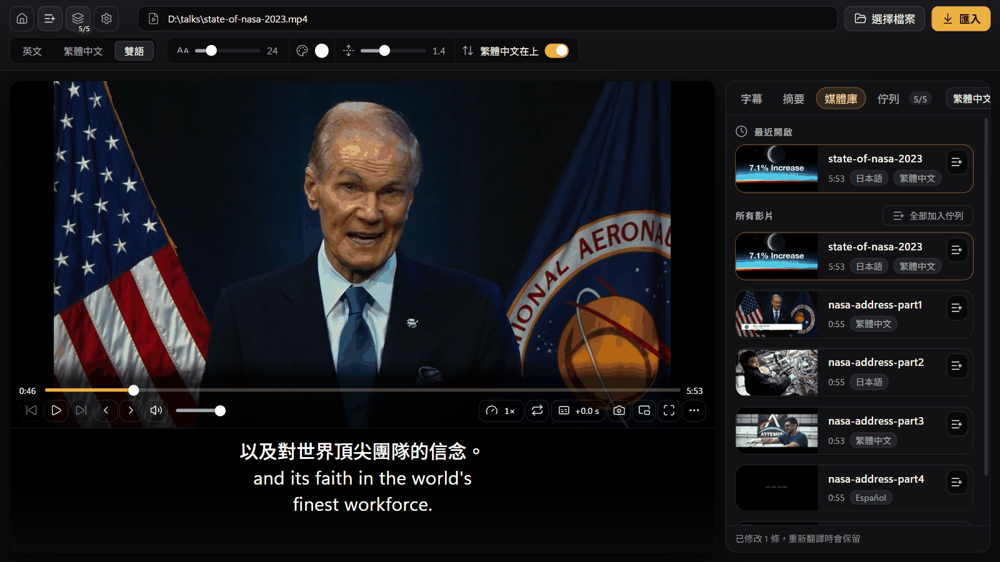

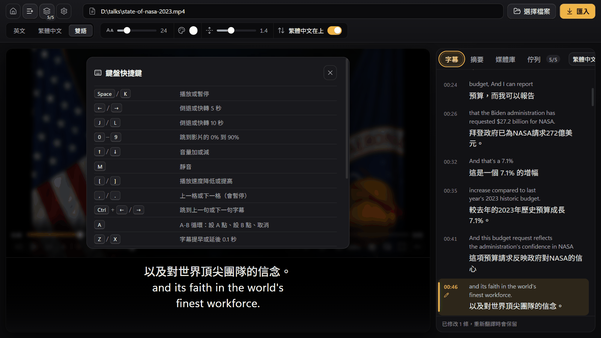

### エクスポート

SRT（原文、訳文、バイリンガル）、ASS、VTT、そして Markdown の要約を書き出せます。字幕ファイルはUTF-8のプレーンテキストで、どのプレーヤーでも開けます。字幕をMP4に焼き込むこともでき、動画全体でも、現在位置からの30秒でも選べます。

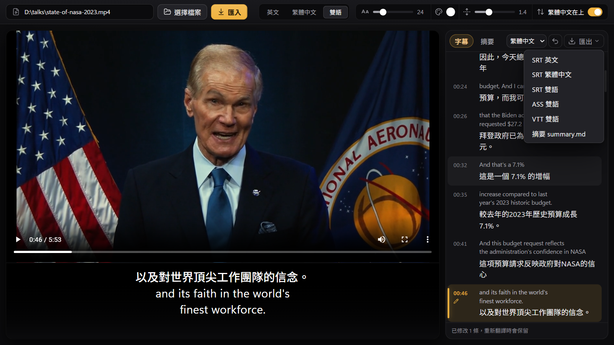

### バッチキュー

たくさんの動画をキューに入れて、夜のうちに処理させることもできます。複数のファイルをまとめて追加するか、フォルダを選ぶか、ウィンドウにドロップして、動画ごとにターゲット言語を選びます。パネルには、各動画の状態、現在のステップ、残り時間の目安が出ます。キュー全体や1本の一時停止、キャンセル、再試行、削除、行をドラッグしての並べ替えができます。終わった行はそのままプレーヤーで開けます。キューが終わると、ウィンドウ内の通知とWindowsの通知が出ます。PCのスリープやシャットダウンもできますが、既定ではオフで、先に確認が必要です。

| 動画を追加し、1本ずつ言語を選ぶ | 処理中のキュー |
| --- | --- |
| 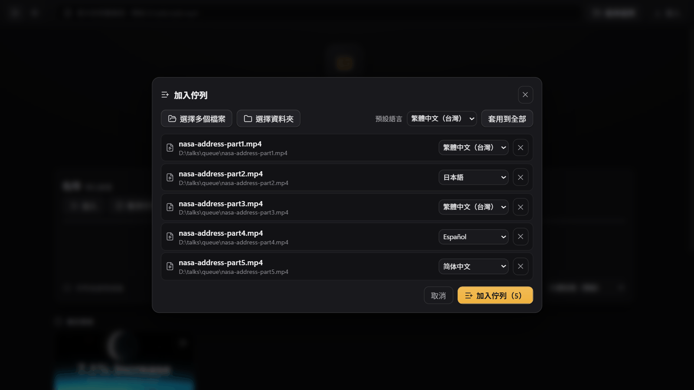 | 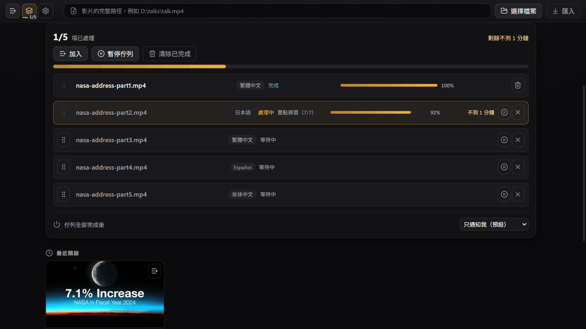 |

### 設定と初回セットアップ

音声認識または翻訳のモデルが入っていない状態で初めて起動すると、セットアップウィザードがGPU、VRAM、ドライバー、RAM、ディスクの空きを調べます。3つのプロファイル（24 GB GPU、8 GB GPU、CPUのみ）から1つを勧め、ダウンロードする項目をサイズとライセンスつきで並べ、進捗を見せながらダウンロードし、取り消すこともできます。最後に自己診断をします。GPUの診断に失敗したときは、CPUに切り替えて理由を伝えます。

歯車のボタンで設定ページが開きます。そこでは、各モデルと実行環境の検証、修復、再ダウンロード、削除、更新の確認、モデルフォルダの移動、プロファイルの切り替え（いつでも可能）、言語モデルの選択（内蔵、Ollama、またはテキストがPCの外に出ることに同意したうえでのクラウドモデル）、各コンポーネントのライセンスの確認ができます。

| 初回セットアップのウィザード | 進捗つきのダウンロード |
| --- | --- |
| 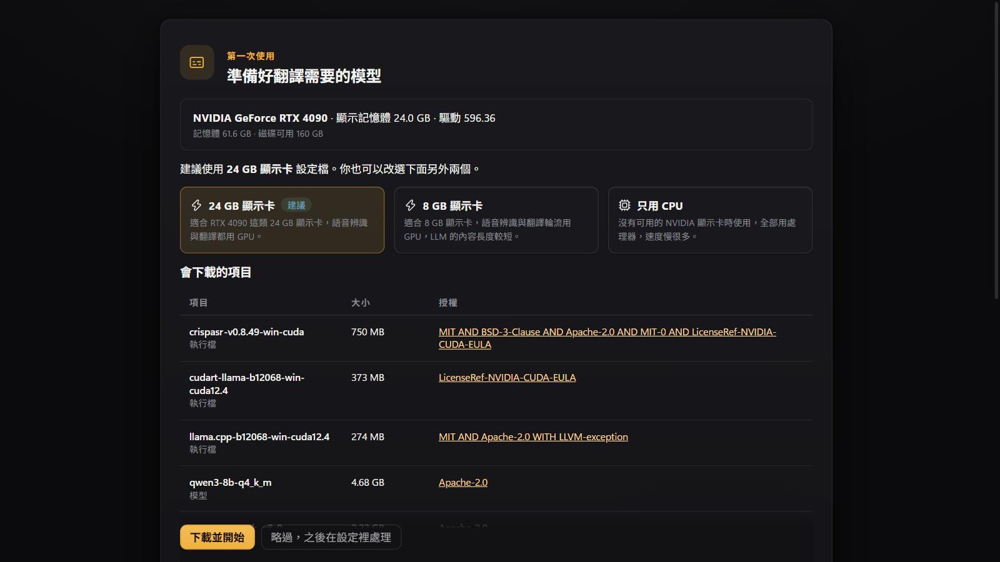 | 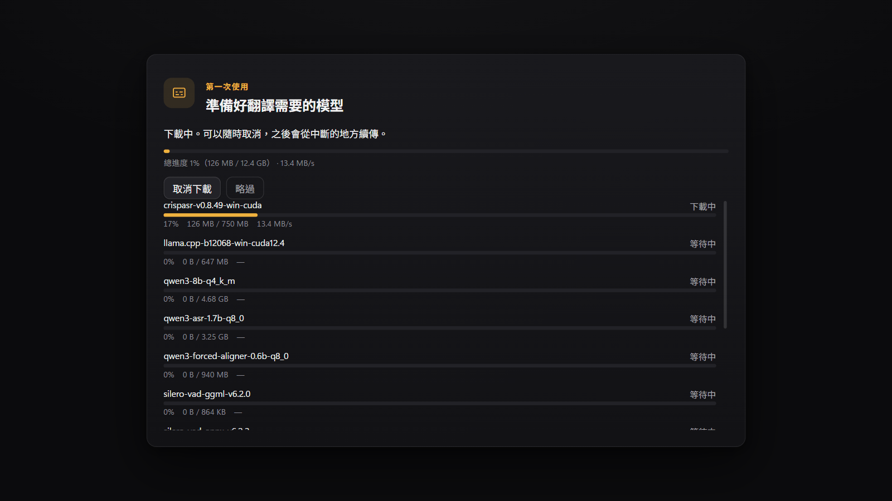 |

| モデルと実行環境 | ハードウェアとプロファイル |
| --- | --- |
| 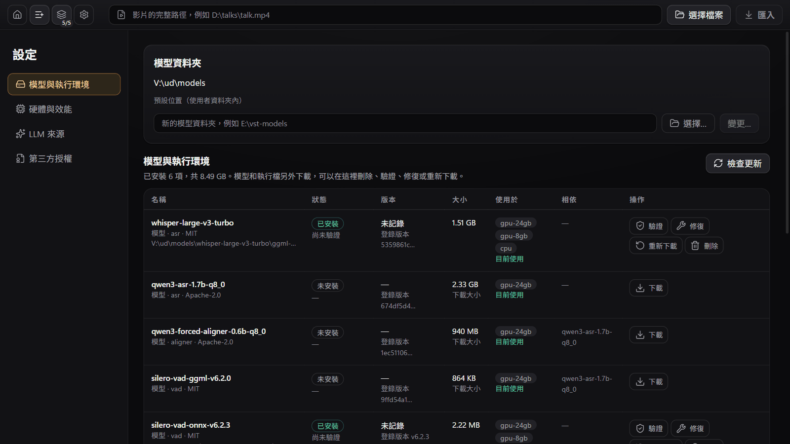 | 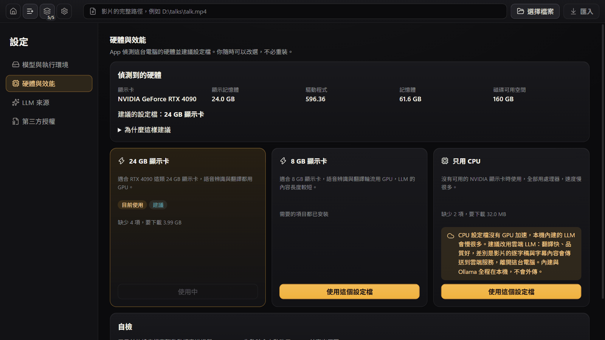 |

### 13のターゲット言語

既定の翻訳先は繁体字中国語（台湾）です。ひとつのプロジェクトに複数の言語を持たせられ、字幕リストの上のセレクターで切り替えます。言語ごとに専用のプロンプトと文字体系のチェックがあり、違う文字で返ってきた訳は却下されてやり直しになります。一覧は[対応しているターゲット言語](#対応しているターゲット言語)にあります。

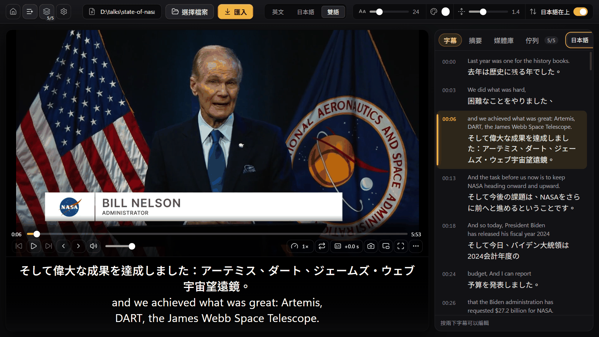

### 英語、日本語、日英混在の動画

取り込むときに「動画の言語」メニューで、動画の中の人が話している言語を選びます。英語（既定）か日本語です。日本語の動画は日本語として音声認識し、日本語の句読点と意味のまとまりで字幕に分け、隣の「字幕の言語」メニューで選んだ言語に翻訳します。既定は繁体字中国語（台湾）で、英語、簡体字中国語、韓国語（実験的）も選べます。日本語のプロジェクトは複数の字幕言語を持てます。リストの上のボタンで言語を足すと翻訳だけをやり直し、リストの上のメニューで、再生、エクスポート、焼き込みに使う言語を切り替えます。バッチキューでは1本の動画に複数の字幕言語を選べ、言語ごとに1行で状態を持ち、失敗した言語だけを再試行できます。翻訳できなかった文はリストに印が付き、件数と理由が出て、その文だけに絞り込めます。プレーヤーのバイリンガル表示では、日本語の原文と繁体字中国語が動画の下に並びます。字幕のずらし、字幕の編集、エクスポート、字幕の焼き込みは英語の動画と同じように使えます。バッチキューの項目ごとにも動画の言語を選べ、ライブラリとキューでは日本語の動画に小さなタグが付きます。原文は翻訳と要約のもとになるので、リストでは直せず、訳文と時刻だけ直せます。日本語字幕の焼き込みには、Yu Gothic、Meiryo、MS Gothic のどれかのフォントがPCに必要で、ない場合はウィンドウが知らせます。

3つ目の選択肢「日本語と英語の混在」は、日本語の話者のあとに英語の話者が続く講演のためのものです。ひとつの動画の中で両方の言語を認識し、字幕の1行ごとにその行の言語を持ちます。字幕リストとエディターでは、原文の横に小さく「日」または「英」が付き、混在の動画にだけ出ます。プレーヤーのバイリンガル表示では、原文の各行がその行の言語で、繁体字中国語の行と並んで出ます。既定では繁体字中国語の行が上で、ツールバーのスイッチ「繁體中文在上」で順序を入れ替えられます。編集で、隣り合う言語の違う行がひとつにまとめられることはありません。ライブラリとキューでは、この動画に「日英混合」のタグが付きます。混在の動画の原文SRTは `<動画名>.ja-en.srt` の名前でエクスポートされ、字幕の焼き込みには日本語の動画と同じ日本語フォントが必要です。混在を選ぶと、出せるのは繁体字中国語の字幕だけで、Qwen3 のモデルファイル（24 GB のモデルセットがインストールします）が必要だという1行の説明が出ます。この選択肢には、その Qwen3 の音声認識エンジンのファイルと GPU が必要で、CPU モードはありません。このPCで動かせないときは、選択肢がグレーになり、理由が書かれます。たとえば、必要なモデルが入っていない場合や、このPCが CPU で動いている場合です。それでもジョブが始まったときは、ウィンドウが拒否のメッセージをそのまま出します。ほかのエンジンに切り替わることはありません。

<!-- PLACEHOLDER(P24a): add a Japanese example screenshot here. It needs Japanese material that may be shown publicly, and none is available yet. -->
> 日本語の例のスクリーンショット：準備中です。例には公開してよい日本語の素材が必要ですが、まだないため、ここには画像を置いていません。

<!-- PLACEHOLDER(P24b): add a mixed Japanese and English example screenshot here. The talks used in testing are private, and no public material exists yet. -->
> 日英混在の例のスクリーンショット：準備中です。テストに使った講演は公開できず、公開してよい素材もまだないため、ここには画像を置いていません。

**言語の自動判定。** 動画を選ぶと（パスの貼り付け、ファイル選択ボタン、追加ダイアログへのファイル追加）、アプリはバックグラウンドで、動画全体から等間隔に5秒の音声を24か所取り出し、それぞれの言語を Whisper に答えてもらいます。RTX 4090 で3〜5秒ほどで、動画の長さには左右されません。ほぼすべてが同じ言語なら「動画の言語」をその言語にしておき、ツールバーの下に「偵測到：日文（信心 100%）」のような1行（検出：日本語、確信度100%）を出します。少ないほうの言語が15%以上あれば、日本語と英語の混在を選んだ状態にします。自分で選んだ言語は置き換えません。選んだ言語がはっきりした判定と違うときは、短いヒントと、1クリックで切り替えるボタンが出ます。これは推測なので、外れることがあります。たとえば日本語の講演に長い英語の部分があると混在と判定されることがあり、とても短い動画は区間が足りず何も判定できません。音楽や雑音だけの動画も、音声検出モデルで話し声を確かめた区間だけを数えるので判定されません。歌声のある曲は試しておらず、言語と判定されることがあります。判定できない、失敗する、時間がかかりすぎる場合は何も起こらず、メニューはそのままです。認識するのは英語と日本語だけです。このPCが混在を処理できないときは、混在と判定されても多いほうの言語を選び、その1行で説明します。CPU で動くPCでは判定しません（1区間に約10秒かかります）。ウィンドウにドロップした1本のファイルは、判定せず、今の選択ですぐに取り込みます。

**制限：** 日本語の動画は、繁体字中国語（台湾）、英語、簡体字中国語、韓国語（実験的）の字幕と要約を出せます。日英混在の動画は繁体字中国語（台湾）だけです。ほかの言語への翻訳はまだ対応していません。日英混在には、Qwen3 のモデルファイル（24 GB のモデルセットがインストールします）と GPU が必要です。動画の言語は自分で選べます。アプリも一度推測しますが（上を参照）、外れることがあり、音声トラックを選ぶこともできません。

### そのほか

- 翻訳には固定のシードを使います。同じ講演をゼロから2回処理したところ、出力された字幕ファイルはバイト単位で一致しました。
- ウィンドウを閉じると、バックエンドと、その下で動く音声認識や言語モデルのプロセスもすべて終了します。
- ウィンドウでできることは、コマンドラインと、トークンで守られたローカルAPIからもできます。

## デモ動画

https://github.com/user-attachments/assets/e2ca30a6-9098-4748-a5a7-86c3687cb118

[動画をダウンロード](docs/media/demo.mp4)。約1分半で、取り込み、進捗、再生、モード切り替え、ショートカット一覧、字幕の編集、要約の章へのジャンプ、2つ目の言語とエクスポート、そのあとバッチキュー、設定ページ、初回セットアップのウィザードの順に見せます。進捗とキューの処理は早送りしています。

## 開発中

以下はまだアプリに入っていません。

- **インストーラー。** インストーラーもダウンロードもまだないので、ソースからビルドします。[ソースからのインストールと実行](#ソースからのインストールと実行)を見てください。
- **日本語の動画のさらに多くのターゲット言語と、日英混在の動画の繁体字中国語以外への翻訳。** 日本語の動画は4言語に翻訳できます（[対応しているターゲット言語](#対応しているターゲット言語)を参照）。日英混在の動画は繁体字中国語（台湾）だけです。
- **音声トラックの選択。** 動画に音声トラックが複数あるときは最初のものを使い、選べません。
- **ほかの元の言語。** 対応しているのは、英語、日本語、その2つの混在だけです。
- **保存したクラウドキーの削除。** ウィンドウからキーの保存と差し替えはできますが、消すことはまだできません。

## システム要件

このプロジェクトは、Windows 11、NVIDIA RTX 4090（VRAM 24 GB）、メモリ 64 GB という1台のマシンだけで開発し、計測しています。ほかの構成は試していません。

- 64ビット版 Windows。動作を確認したのは Windows 11 です。
- NVIDIA の GPU と新しめのドライバー。CUDA Toolkit のインストールは不要です。
- 既定のプロファイルは VRAM 16 GB 以上を前提にしています。バックエンドには、VRAM 7 GB 以上向けの 8 GB プロファイルと、CPU のみのプロファイルもありますが、該当するハードウェアでの実行は未確認です。
- 実行環境とモデルに必要なディスク容量は、既定のプロファイルで約12 GB（予備の音声認識エンジンも取得します）、8 GB プロファイルで約8 GB です。プロジェクトフォルダの分も見込んでください。
- `PATH` に ffmpeg があること。または、そのフォルダを `VST_FFMPEG_DIR` に設定してください。

## ソースからのインストールと実行

**アプリはまだパッケージ化されていません。** インストーラーもダウンロードもないので、自分でビルドします。以下の手順は開発者向けです。

必要なものは、Python 3.11 以降と [uv](https://docs.astral.sh/uv/)、Node.js と npm、Rust と MSVC ツールチェーン（Tauri 2 の前提条件）、そして ffmpeg です。

```powershell
git clone https://github.com/ANONEKO777/speech-subtitle-ai.git
cd speech-subtitle-ai

uv sync                                   # バックエンド環境（.venv）
npm --prefix app ci                       # フロントエンドの依存パッケージ
cd app; npx tauri build --no-bundle; cd ..   # app/src-tauri/target/release/video-subtitle-translator.exe ができる
```

音声認識と言語のモデル、およびその実行環境はリポジトリに入っていません。`app/src-tauri/target/release/video-subtitle-translator.exe` を起動します。モデルが1つも入っていないと、セットアップウィザードが、お使いのハードウェアに必要なものを公開元からダウンロードするよう提案します。ネットワークが必要で、既定のプロファイルではディスクを約12 GB使います。スキップして、あとで設定ページからダウンロードすることもできます。

ファイルは `%LOCALAPPDATA%\video-subtitle-translator` に置かれます（別のフォルダにするには `VST_USER_DATA` を設定します）。ウィンドウは `.venv` のPythonバックエンドを起動し、ウィンドウを閉じると一緒に止めます。

## 使い方

### ウィンドウから

1. 動画のフルパスを貼り付けるか、ファイル選択ボタンを押し、その隣の「動画の言語」で英語、日本語、日本語と英語の混在のどれかを選んで、取り込みボタンを押します。動画を選んだ時点で、アプリが言語を一度推測して選んでおきます（自分で選んだ言語は置き換えません）。進捗画面に現在のステップが出ます。たくさんの動画を処理するときは、追加ボタンを押すか、複数のファイルをウィンドウにドロップして、動画ごとに言語を選びます。
2. 完了するとプレーヤーが開きます。処理済みの動画は、止めた場所からそのままプレーヤーで開き、ほかの動画はライブラリのタブに並びます。
3. 上のモード切り替えで、原文のみ、訳文のみ、両方を選びます。字幕の大きさ、色、行間はツールバーで変えられます。
4. 字幕をダブルクリックして編集します。要約タブで章の時刻をクリックするとジャンプし、エクスポートメニューからファイルを保存します。`?` を押すと、すべてのキーボードショートカットが出ます。
5. 歯車のボタンで設定ページが開き、モデル、ハードウェアのプロファイル、言語モデルを管理できます。

ウィンドウが再生できるのは、システムの WebView2 でデコードできる形式です。いちばん確実なのは、H.264 と AAC の MP4 です。再生できないときはウィンドウがそう知らせ、H.264/AAC の MP4 コピーを用意するよう案内します。

### コマンドラインから

```powershell
uv run python -m backend.cli talk.mp4 --lang ja
```

動画の隣に `talk.vst\` が作られ、`en.srt`、`ja.srt`、`bilingual.en-ja.ass`、`summary.ja.md`、`project.json` が入ります。同じコマンドをもう一度実行しても、すべてのステップがキャッシュされているので何も起きません。`--lang` には[対応しているターゲット言語](#対応しているターゲット言語)のコードを指定でき、`--help` で全オプションが分かります。ひとつのプロジェクトは、言語ごとにひとつの訳を保持します。

日本語の動画には `--source-lang ja` を使います。既定では繁体字中国語に翻訳し、`--lang en`、`--lang zh-CN`、`--lang ko` でほかのターゲットを選べます。

```powershell
uv run python -m backend.cli talk.mp4 --source-lang ja
```

プロジェクトフォルダでは、日本語の原文字幕が `ja.srt`、訳文が `zh-TW.srt` です。

日本語と英語が混ざる講演には `--source-lang ja+en` を使います。こちらも繁体字中国語だけに翻訳し、24 GB プロファイルがインストールする Qwen3 のモデルファイルが必要です。

```powershell
uv run python -m backend.cli talk.mp4 --source-lang ja+en
```

プロジェクトフォルダでは、原文字幕が `src.srt`、訳文が `zh-TW.srt` です。

## プライバシー

音声認識と翻訳は、既定ではすべてお使いのPCで動きます。動画、音声、文字起こしがPCの外に出ることはありません。ローカルAPIは `127.0.0.1` だけで待ち受け、トークンが必要です。

クラウドの言語モデルは任意で、既定では無効です。使う場合、あなたが明示的に同意するまで、バックエンドは設定の保存を拒否します。動画のテキストがPCの外に出ることになるためです。APIキーは Windows DPAPI で暗号化され、書き込みはできてもAPIから読み出すことはできず、設定ファイルやログにも残りません。設定ページで選ぶと、ウィンドウが先に同意を求めます。

任意のクラウドモデルを除けば、ネットワークが必要なのは、モデルと実行環境をダウンロードするときだけです。

## 対応しているターゲット言語

| コード | 言語 | 備考 |
| --- | --- | --- |
| zh-TW | 繁体字中国語（台湾） | 既定 |
| zh-CN | 簡体字中国語 | |
| ja | 日本語 | |
| ko | 韓国語 | 実験的 |
| es | スペイン語 | |
| fr | フランス語 | |
| de | ドイツ語 | |
| pt | ポルトガル語 | |
| it | イタリア語 | |
| ru | ロシア語 | |
| vi | ベトナム語 | |
| th | タイ語 | 実験的 |
| id | インドネシア語 | |

動画の言語（動画の中の人が話す言語）によって、出せる字幕の言語が決まります。

| 動画の言語 | 出せる字幕の言語 | 備考 |
| --- | --- | --- |
| 英語 | 上の表の13言語 | 既定 |
| 日本語 | 繁体字中国語（台湾）、英語、簡体字中国語、韓国語 | 下の表を見てください |
| 日本語と英語の混在 | 繁体字中国語（台湾） | Qwen3 のモデルファイル（24 GB のモデルセットがインストールします）と GPU が必要です。ほかの言語はまだ対応していません |

日本語の動画は、次の言語に翻訳できます。ひとつのプロジェクトに複数の言語を並べて持て、言語を足すときは翻訳だけをやり直し、音声認識はやり直しません。

| 日本語の動画の字幕の言語 | 状態 |
| --- | --- |
| 繁体字中国語（台湾） | 対応、既定 |
| 英語 | 対応。日本語から直接翻訳します |
| 簡体字中国語 | 対応。日本語から直接翻訳し、繁体字中国語を経由しません |
| 韓国語 | 実験的 |
| 上の表のほかの9言語 | このバージョンにはありません |

英語と簡体字中国語は、自動チェックと、それぞれ12文の目隠し評価で確認しました。韓国語とほかの言語はまだ評価していません。チェックを通らなかった文は、英語と簡体字中国語では空欄になり、韓国語では英語で表示され、ウィンドウに印が出ます。

品質は言語によって違います。38分の講演で逆翻訳によるチェックを行ったところ、スペイン語、簡体字中国語、ドイツ語は繁体字中国語と同程度、日本語はやや低く、韓国語は明らかに低い結果でした。韓国語では、固有名詞や意味が誤っている行もありました。このため、韓国語とタイ語は実験的としています。13言語のうち、実際の講演でひととおり通して動かしたのは6言語（zh-TW、zh-CN、ja、ko、es、de）で、残りはテストでの確認のみです。

## 素材の出典

スクリーンショットとデモ動画には、NASA長官ビル・ネルソン氏による2023年3月9日の「State of NASA」演説の一部を使っています（[NASA Image and Video Library](https://images.nasa.gov/details/2023%20%E2%80%98State%20of%20NASA%E2%80%99%20Address%20from%20Administrator%20Bill%20Nelson)）。切り出したのは元動画の1:14から7:07です。NASAのメディアは米国では一般に著作権の対象外ですが、[NASAのメディア利用ガイドライン](https://www.nasa.gov/nasa-brand-center/images-and-media/)に従ってください。NASAがこのプロジェクトを推奨しているわけではありません。動画そのものはこのリポジトリに含まれていません。画像の中の字幕と要約は、このアプリが生成したものです。

## ライセンス

[GNU Affero General Public License v3.0 or later](LICENSE)（AGPL-3.0-or-later）。サードパーティの表示は [THIRD-PARTY-NOTICES.md](THIRD-PARTY-NOTICES.md) にあります。
