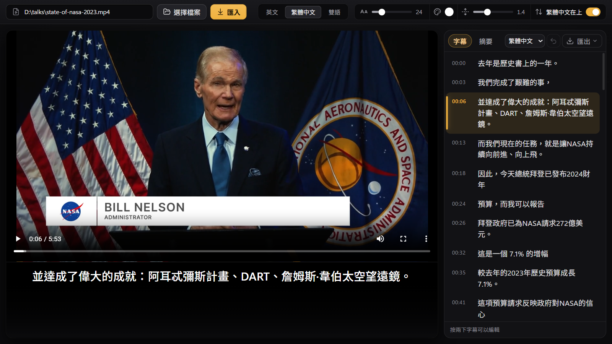
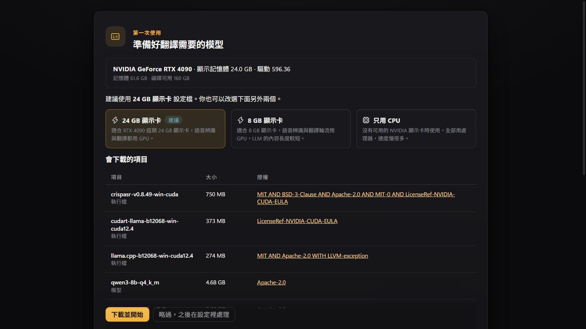

<div align="center">

**繁體中文** | [English](README.en.md) | [简体中文](README.zh-CN.md) | [日本語](README.ja.md)

# Video Subtitle Translator（字幕翻譯）

**在自己的電腦與顯示卡上，把英文或日文的長演講變成時間準確的雙語字幕與重點整理。**


</div>

選一部沒有字幕的英文、日文，或日文與英文混合的演講影片。程式會辨識語音、切成字幕、翻譯、寫出附章節的摘要，再讓你在影片下方看著字幕播放。每一個步驟都在你的電腦上執行。在 RTX 4090 上，一場 38 分鐘的演講約 5 到 6 分鐘就能處理完。

## 特色

### 整條流程都在本機執行

匯入影片後，視窗會即時顯示七個步驟：擷取音訊、偵測語音、語音辨識、斷句、翻譯、輸出字幕、重點摘要。每一步的結果都存在專案資料夾裡。再跑一次，做完的步驟會直接略過。中途停掉，下次從停下的那一步接著做。換翻譯模型時，只會重跑翻譯、輸出與摘要。


### 影片下方的雙語字幕

字幕放在影片下方，不蓋住畫面，也不燒進影片檔。你可以切換成只看原文、只看翻譯，或兩個一起看。切換時影片大小不會變，右側的字幕清單會跟著播放進度捲動，點一條字幕就能跳到那裡。

| 只看原文 | 只看翻譯 | 雙語 |
| --- | --- | --- |
|  |  |  |

### 直接在清單裡改字幕

在字幕上按兩下，或選取後按 F2，就能修改時間與文字。Enter 儲存，Esc 取消，Ctrl+Z 復原。不合理的修改會被擋下，原因直接顯示在那一列：和下一條重疊、結束時間早於開始、超過 7 秒、內容是空的、時間格式錯誤。英文那一行是辨識結果，只能讀不能改，因為各語言的翻譯與摘要都是從它產生的。

手動修改過的字幕不會被無聲覆蓋。如果你從命令列或 API 對同一個專案重新翻譯，你的修改會疊回新的翻譯上，執行報告會說明保留了幾條、有幾條已對不上。

| 被擋下的修改 | 已儲存的修改 |
| --- | --- |
|  |  |

### 附章節的重點整理

摘要分頁會列出一句話總結、帶時間的章節、關鍵觀點與結論。點章節的時間，影片就跳到那一秒。


### 有媒體庫的完整播放器

每一部處理完的演講都收在媒體庫裡，有縮圖、語言標籤與接續播放的進度條。播放佇列會一部接著一部播，下次打開會回到你上次停下的地方。控制列疊在畫面下緣，字幕仍然留在畫面下方。你有播放、上一部與下一部、上一句與下一句、音量、拖曳進度列、0.5 到 2 倍的速度、A-B 循環、字幕時間偏移、目前畫面的截圖、子母畫面與全螢幕。逐格播放與其他按鍵都在鍵盤上，按 `?` 會列出全部。把影片拖到視窗上就能匯入。

偏移不會改寫字幕本身。它只在播放與匯出時套用，所以可以隨時收回。


### 匯出

可以匯出 SRT（原文、翻譯、雙語）、ASS、VTT，以及 Markdown 格式的摘要。字幕檔是純 UTF-8 文字，任何播放器都能開。也可以把字幕燒進 MP4，整部影片或從目前位置起的 30 秒都行。


### 批次佇列

一次排入很多部影片，讓它們跑，夜裡也行。可以一次加入多個檔案、選一個資料夾，或把檔案拖到視窗上，並為每部影片選目標語言。面板會顯示每部影片的狀態、目前步驟與預估剩餘時間。可以暫停整個佇列或單一影片、取消、重試、移除，也可以拖曳一列來調整順序。處理完的那一列可以直接在播放器開啟。佇列結束時，視窗內會有通知，Windows 也會跳出通知。程式也能讓電腦睡眠或關機，但預設關閉，而且要先經過你的確認。

| 加入影片，每部各選語言 | 佇列運作中 |
| --- | --- |
|  |  |

### 設定與第一次使用

第一次啟動時，如果沒有安裝語音或翻譯模型，設定精靈會偵測你的顯示卡、顯存、驅動程式、記憶體與可用磁碟，從三種設定檔（24 GB 顯示卡、8 GB 顯示卡、只用 CPU）裡推薦一個，列出每個要下載的項目與它的大小和授權，顯示下載進度並可以取消，最後做一次自我檢測。如果 GPU 檢測失敗，會退回 CPU 並說明原因。

齒輪按鈕會開啟設定頁。你可以在那裡驗證、修復、重新下載或刪除每個模型與執行環境、檢查更新、搬移模型資料夾、隨時切換設定檔、選擇語言模型（內建、Ollama，或在你同意文字會離開電腦之後使用雲端模型），也能查看每個元件的授權。

| 第一次使用精靈 | 下載中，附進度 |
| --- | --- |
|  |  |

| 模型與執行環境 | 硬體與設定檔 |
| --- | --- |
|  |  |

### 十三種目標語言

預設翻成繁體中文（台灣）。同一個專案可以同時放多個語言，字幕清單上方的選單可以切換。每個語言都有自己的提示詞與文字系統檢查，回覆用錯文字會被退回重問。清單見[支援的目標語言](#支援的目標語言)。


### 英文、日文與日英混合影片

匯入時用「影片語言」選單告訴程式影片裡的人說什麼話：英文（預設）或日文。日文影片會用日文辨識語音，依日文的標點與語意單位切成字幕，再翻成旁邊「字幕語言」選單選的語言：預設繁體中文（台灣），也可以選英文、簡體中文或韓文（實驗性）。日文專案可以同時有好幾種字幕語言：字幕清單上方的按鈕可以再加一種，只會重新翻譯，清單上方的選單切換播放、匯出與燒入字幕用的語言。批次佇列裡一部影片可以選好幾種字幕語言，每種各一列、各有狀態，失敗的那一種可以單獨重試。翻譯不出來的句子會在字幕清單上標出，附上數量與原因，也可以只看這些句子。播放器的雙語模式在影片下方同時顯示日文原文與繁體中文，字幕偏移、修改字幕、匯出與燒入字幕都和英文影片一樣。批次佇列的每個項目也能各自選影片語言，媒體庫與佇列會在日文影片上加一個小標籤。原文是翻譯與摘要的來源，所以不能在清單裡修改，只能改譯文與時間。燒入日文字幕需要電腦裝有 Yu Gothic、Meiryo 或 MS Gothic 其中一種字型，沒有的話視窗會說明。

第三個選項「日文與英文混合」，給日文講者後面接英文講者的演講。程式在同一支影片裡辨識兩種語言，每則字幕保留自己的語言。字幕清單與編輯器會在每則原文旁加一個小小的「日」或「英」，只在混合影片裡出現。播放器的雙語模式會用每則字幕自己的語言顯示原文，與繁體中文上下並列。預設繁體中文在上，工具列的「繁體中文在上」開關可以對調順序。編輯時，相鄰但語言不同的兩則字幕不會被合併。媒體庫與佇列會在這種影片上加「日英混合」標籤。混合影片的原文 SRT 匯出成 `<影片名>.ja-en.srt`，燒入字幕需要的日文字型和日文影片相同。選了混合時會出現一行說明，說只輸出繁體中文字幕，需要 Qwen3 的模型檔，24 GB 的模型組會安裝。這個選項需要這些 Qwen3 語音引擎的檔案與一張顯示卡，沒有 CPU 模式。這台電腦跑不了時，選項會變灰並寫出原因，例如沒有安裝所需的模型，或這台電腦目前以 CPU 執行。如果工作還是被啟動，視窗會照原樣顯示被拒絕的訊息，程式不會改用別的引擎。

<!-- PLACEHOLDER(P24a): add a Japanese example screenshot here. It needs Japanese material that may be shown publicly, and none is available yet. -->
> 日文範例截圖：待補。範例必須用可以公開使用的日文素材，目前還沒有，所以這裡先不放圖。

<!-- PLACEHOLDER(P24b): add a mixed Japanese and English example screenshot here. The talks used in testing are private, and no public material exists yet. -->
> 日英混合範例截圖：待補。測試用的演講不能公開，目前也沒有可以公開的素材，所以這裡先不放圖。

**自動偵測語言。** 選好影片後（貼上路徑、按「選擇檔案」，或在加入對話框加入檔案），程式會在背景從影片均勻取 24 段各 5 秒的音訊，請 Whisper 說出每一段的語言。在 RTX 4090 上約 3 到 5 秒，和影片的長短無關。幾乎每一段都是同一種語言時，「影片語言」會預選成那一種，工具列下方寫一行，例如「偵測到：日文（信心 100%）」。較少的那種語言占 15% 以上時，預選「日文與英文混合」。你自己選過的語言不會被換掉；你選的和偵測結果明顯不同時，會出現一行提示和一個一鍵切換的按鈕。這只是猜測，可能猜錯，例如日文演講中間有一大段英文，可能被判成混合，太短的影片段數不夠，什麼也猜不出來。只有音樂或雜訊、沒有人聲的影片也猜不出來，因為沒有人聲的段不算（用語音偵測模型確認）；人聲很重的歌曲沒有測過，可能被判成一種語言。猜不出來、失敗或逾時，視窗什麼都不做，選單維持原樣。只認得英文與日文。這台電腦不能處理混合語言時，偵測到混合會預選占多數的那種語言，並在那一行說明。用 CPU 執行的電腦不做偵測（每一段約要 10 秒）。把單一檔案拖到視窗上會立刻用目前的選擇匯入，不做偵測。

**限制：** 日文影片可以輸出繁體中文（台灣）、英文、簡體中文與韓文（實驗性）的字幕與摘要。日英混合影片只能輸出繁體中文（台灣）。翻成其他語言還不支援。日英混合需要 Qwen3 的模型檔（24 GB 的模型組會安裝）與顯示卡。影片語言可以自己選，程式也會猜一次（見上），但猜得不一定對，也不能選音軌。

### 其他

- 翻譯使用固定的隨機種子。同一場演講從頭跑兩次，產生的字幕檔逐位元組相同。
- 關閉視窗時，後端與它底下所有語音、語言模型的程序都會一起結束。
- 視窗能做的事，命令列與有權杖保護的本機 API 也都能做。

## 示範影片


[下載影片](docs/media/demo.mp4)。約一分半鐘，依序是匯入、進度、播放、切換模式、快捷鍵清單、修改字幕、跳到摘要章節、換成第二個語言並匯出，接著是批次佇列、設定頁與第一次使用精靈。進度與佇列執行的部分經過加速。

## 開發中

以下功能還沒有放進程式。

- **安裝程式。** 目前沒有安裝程式，也沒有下載連結，所以要從原始碼建置。請看[從原始碼安裝與執行](#從原始碼安裝與執行)。
- **日文影片的更多目標語言，以及日英混合影片翻成繁體中文以外的語言。** 日文影片可以翻成四種語言（見[支援的目標語言](#支援的目標語言)），日英混合影片只能翻成繁體中文（台灣）。
- **選音軌。** 影片有好幾個音軌時，程式用第一個，不能選。
- **其他來源語言。** 目前只支援英文、日文，以及兩者混合。
- **刪除已儲存的雲端金鑰。** 視窗可以儲存與替換金鑰，但還不能移除。

## 系統需求

這個專案只在一台機器上開發與量測：Windows 11、NVIDIA RTX 4090（24 GB 顯存）、64 GB 記憶體。其他組合沒有測過。

- 64 位元 Windows，已測試的系統是 Windows 11。
- NVIDIA 顯示卡與新版驅動程式，不需要另外安裝 CUDA Toolkit。
- 預設設定檔要求至少 16 GB 顯存。後端另有 8 GB 設定檔（顯存 7 GB 以上）與純 CPU 設定檔，這兩個還沒有在對應的硬體上實際跑過。
- 執行環境與模型的磁碟空間：預設設定檔約 12 GB（會多下載一個備援語音引擎），8 GB 設定檔約 8 GB。另外要預留專案資料夾的空間。
- `PATH` 裡要有 ffmpeg，或把它的資料夾設在 `VST_FFMPEG_DIR`。

## 從原始碼安裝與執行

**程式還沒有打包。** 目前沒有安裝程式，也沒有下載連結，必須自己建置。以下步驟寫給開發者。

需要 Python 3.11 以上與 [uv](https://docs.astral.sh/uv/)、Node.js 與 npm、Rust 與 MSVC 工具鏈（Tauri 2 的前置需求），以及 ffmpeg。

```powershell
git clone https://cggitlab.chinesegamer.net/abcd1997/speech-subtitle-ai.git
cd speech-subtitle-ai

uv sync                                   # 後端環境，建立 .venv
npm --prefix app ci                       # 前端相依套件
cd app; npx tauri build --no-bundle; cd ..   # 產生 app/src-tauri/target/release/video-subtitle-translator.exe
```

語音與語言模型及其執行環境不在儲存倉裡。執行 `app/src-tauri/target/release/video-subtitle-translator.exe`。沒有安裝任何模型時，設定精靈會提議從它們的公開來源下載你的硬體需要的那些。這需要網路，預設設定檔約要 12 GB 的磁碟空間。你可以略過，之後再到設定頁下載。

檔案會放在 `%LOCALAPPDATA%\video-subtitle-translator`，要換資料夾就設定 `VST_USER_DATA`。視窗會用 `.venv` 啟動 Python 後端，關閉視窗時一併結束。

## 使用方式

### 在視窗裡

1. 貼上影片的完整路徑，或按「選擇檔案」，用旁邊的「影片語言」選英文、日文或日文與英文混合，再按「匯入」。選好影片時，程式會猜一次語言並預選（你自己選過的不會被換掉）。進度畫面會顯示目前的步驟。要處理很多部影片時，按「加入」，或把多個檔案拖到視窗上，並為每部選語言。
2. 完成後會進入播放器。處理過的影片會直接開在播放器，回到你上次停下的地方，媒體庫分頁會列出其他影片。
3. 用上方的模式切換選擇只看原文、只看翻譯或雙語。字幕的大小、顏色與行距可以在工具列調整。
4. 在字幕上按兩下就能修改。開啟摘要分頁、點章節時間可以跳轉，用匯出選單存檔。按 `?` 會列出所有鍵盤快捷鍵。
5. 齒輪按鈕會開啟設定頁，管理模型、硬體設定檔與語言模型。

視窗能播放系統 WebView2 解得開的格式，最保險的是 MP4 裝 H.264 與 AAC。影片播不出來時，視窗會說明，並請你提供 H.264/AAC 的 MP4 副本。

### 在命令列

```powershell
uv run python -m backend.cli talk.mp4 --lang ja
```

這會在影片旁邊建立 `talk.vst\`，裡面有 `en.srt`、`ja.srt`、`bilingual.en-ja.ass`、`summary.ja.md` 與 `project.json`。同樣的指令再跑一次不會做任何事，因為每一步都有快取。`--lang` 可以填[支援的目標語言](#支援的目標語言)裡的任何代碼，`--help` 會列出全部選項。一個專案對每個語言各保留一份翻譯。

日文影片用 `--source-lang ja`，預設翻成繁體中文，用 `--lang en`、`--lang zh-CN` 或 `--lang ko` 選別的目標：

```powershell
uv run python -m backend.cli talk.mp4 --source-lang ja
```

專案資料夾裡的日文原文字幕是 `ja.srt`，翻譯是 `zh-TW.srt`。

日文與英文混著講的演講用 `--source-lang ja+en`，同樣只翻成繁體中文，需要 Qwen3 的模型檔（24 GB 設定檔會安裝）：

```powershell
uv run python -m backend.cli talk.mp4 --source-lang ja+en
```

專案資料夾裡的原文字幕是 `src.srt`，翻譯是 `zh-TW.srt`。

## 隱私

語音辨識與翻譯預設都在你的電腦上執行。影片、音訊與逐字稿不會離開本機，本機 API 只監聽 `127.0.0.1`，並且需要權杖。

雲端語言模型是選用功能，預設關閉。若你選用，後端在你明確同意之前拒絕儲存設定，因為影片的文字內容會離開你的電腦。API 金鑰以 Windows DPAPI 加密，只能寫入、無法透過 API 讀回，也不會出現在設定檔與日誌裡。你在設定頁選用它，視窗會先請你同意。

除了選用的雲端模型，只有下載模型與執行環境時才需要網路。

## 支援的目標語言

| 代碼 | 語言 | 備註 |
| --- | --- | --- |
| zh-TW | 繁體中文（台灣） | 預設 |
| zh-CN | 簡體中文 | |
| ja | 日文 | |
| ko | 韓文 | 實驗性 |
| es | 西班牙文 | |
| fr | 法文 | |
| de | 德文 | |
| pt | 葡萄牙文 | |
| it | 義大利文 | |
| ru | 俄文 | |
| vi | 越南文 | |
| th | 泰文 | 實驗性 |
| id | 印尼文 | |

影片語言（影片裡的人說的話）決定能輸出哪些字幕語言：

| 影片語言 | 可輸出的字幕語言 | 備註 |
| --- | --- | --- |
| 英文 | 上表的十三種 | 預設 |
| 日文 | 繁體中文（台灣）、英文、簡體中文、韓文 | 見下表 |
| 日文與英文混合 | 繁體中文（台灣） | 需要 Qwen3 的模型檔（24 GB 的模型組會安裝）與顯示卡，其他語言還不支援 |

日文影片可以翻成下面這些語言。一個專案可以同時有好幾種，再加一種只會重新翻譯，不會重跑語音辨識。

| 日文影片的字幕語言 | 狀態 |
| --- | --- |
| 繁體中文（台灣） | 支援，預設 |
| 英文 | 支援，直接從日文翻 |
| 簡體中文 | 支援，直接從日文翻，不經過繁體中文 |
| 韓文 | 實驗性 |
| 上表的其他九種語言 | 這個版本沒有 |

英文與簡體中文經過自動檢查，以及各 12 句的盲測評分。韓文與其他語言還沒有評分。通不過檢查的句子，英文與簡體中文會留空，韓文會改用英文顯示，視窗會標出來。

各語言的品質不同。在 38 分鐘的演講上，用回譯檢查打分數：西班牙文、簡體中文與德文和繁體中文相當，日文略低，韓文明顯較低，有些句子的人名與語意是錯的。韓文與泰文因此標為實驗性。十三種語言裡，有六種在真實演講上完整跑過（zh-TW、zh-CN、ja、ko、es、de），其餘只有測試覆蓋。

## 素材來源

截圖與示範影片使用 NASA 局長 Bill Nelson 的「State of NASA」演說片段，演說日期是 2023 年 3 月 9 日（[NASA Image and Video Library](https://images.nasa.gov/details/2023%20%E2%80%98State%20of%20NASA%E2%80%99%20Address%20from%20Administrator%20Bill%20Nelson)）。片段取自原片的 1:14 到 7:07。NASA 的媒體在美國一般不受著作權保護，仍請參考 [NASA 的媒體使用規範](https://www.nasa.gov/nasa-brand-center/images-and-media/)，NASA 不為本專案背書。影片本身不在這個儲存倉裡。圖中的字幕與摘要由本程式產生。

## 授權

[GNU Affero General Public License v3.0 or later](LICENSE)（AGPL-3.0-or-later）。第三方聲明在 [THIRD-PARTY-NOTICES.md](THIRD-PARTY-NOTICES.md)。
