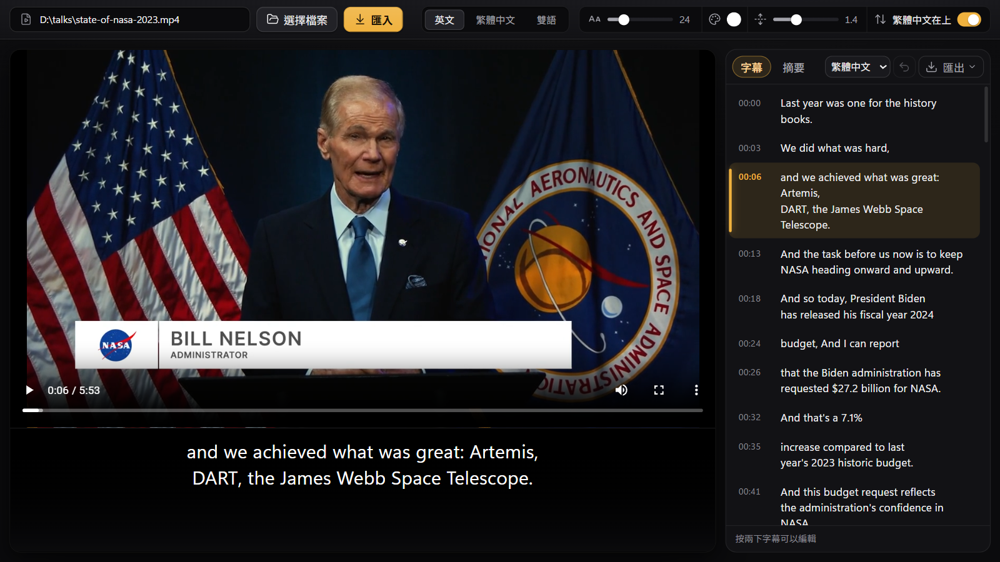
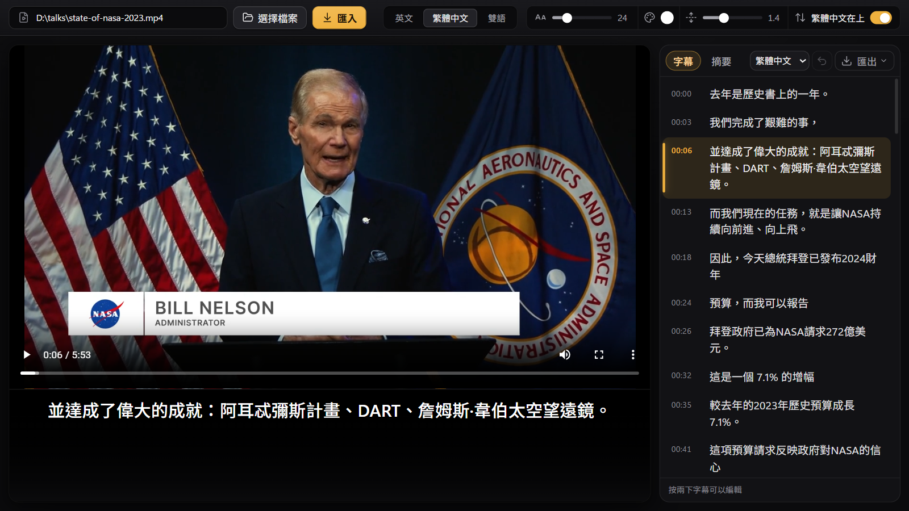
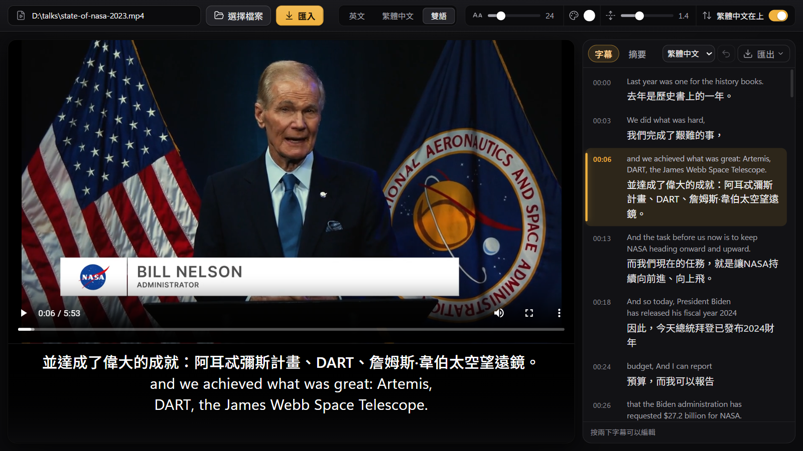
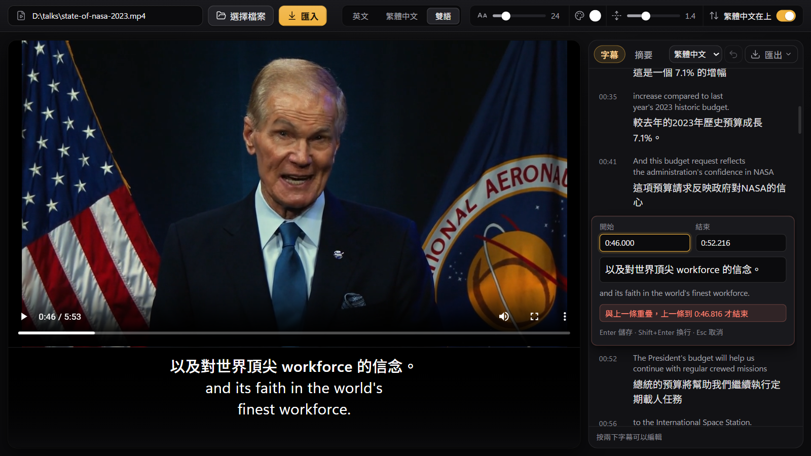
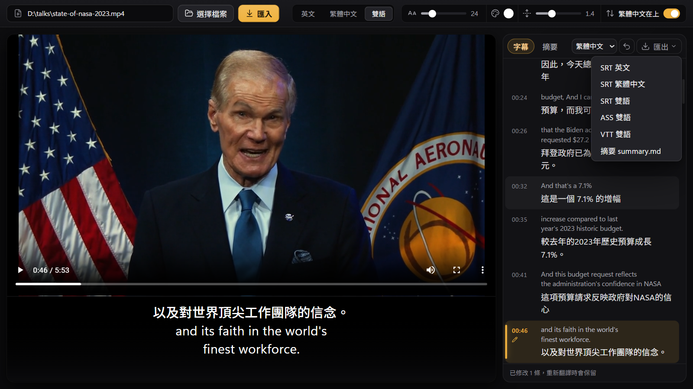
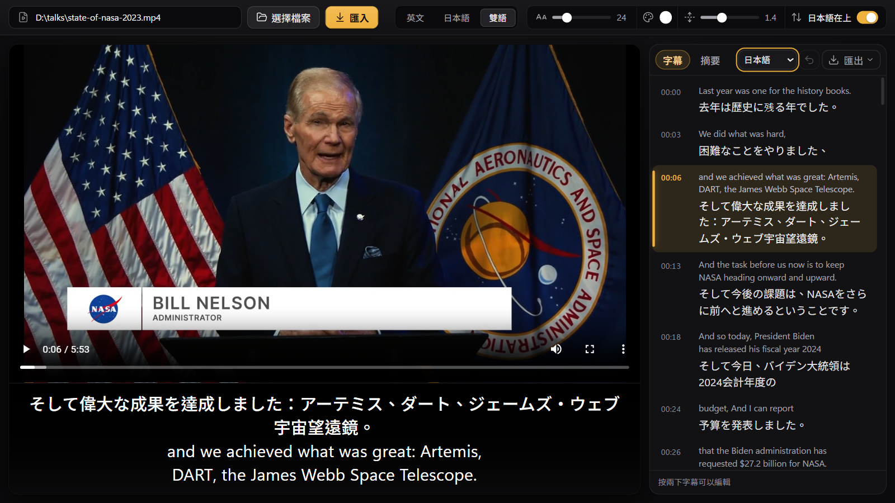

<div align="center">

[繁體中文](README.md) | [English](README.en.md) | **简体中文** | [日本語](README.ja.md)

# Video Subtitle Translator（字幕翻译）

**在自己的电脑和显卡上，把英文长演讲变成时间准确的双语字幕和要点总结。**


</div>

选一个没有字幕的英文演讲视频。程序会识别语音、切成字幕、翻译、写出带章节的总结，然后让你在视频下方看着字幕播放。每一步都在你自己的电脑上运行。在 RTX 4090 上，一场 38 分钟的演讲大约 5 到 6 分钟就能处理完。

## 特色

### 整条流程都在本机运行

导入视频后，窗口会实时显示七个步骤：提取音频、检测语音、语音识别、断句、翻译、输出字幕、要点总结。每一步的结果都保存在项目文件夹里。再运行一次，已经完成的步骤会直接跳过。中途停掉，下次从停下的那一步接着做。换翻译模型时，只会重跑翻译、输出和总结。


### 视频下方的双语字幕

字幕放在视频下方，不遮挡画面，也不烧录进视频文件。你可以切换为只看英文、只看译文，或者两者同时显示。切换时视频大小不变，右侧的字幕列表会跟着播放进度滚动，点一条字幕就能跳到那里。

| 只看英文 | 只看译文 | 双语 |
| --- | --- | --- |
|  |  |  |

### 直接在列表里改字幕

双击一条字幕，或者选中后按 F2，就可以修改时间和文字。Enter 保存，Esc 取消，Ctrl+Z 撤销。不合理的修改会被拒绝，原因直接显示在那一行：与下一条重叠、结束时间早于开始时间、超过 7 秒、内容为空、时间格式不对。英文那一行是识别结果，只读不能改，因为各语言的译文和总结都由它生成。

手动修改过的字幕不会被悄悄覆盖。如果你从命令行或 API 对同一个项目重新翻译，你的修改会叠加回新的译文上，运行报告会说明保留了多少条、有多少条已经对不上。

| 被拒绝的修改 | 已保存的修改 |
| --- | --- |
|  |  |

### 带章节的要点总结

总结标签页会列出一句话概括、带时间的章节、关键观点和结论。点击章节的时间，视频就跳到那一秒。


### 导出

可以导出 SRT（英文、译文、双语）、ASS、VTT，以及 Markdown 格式的总结。字幕文件是纯 UTF-8 文本，任何播放器都能打开。



### 十三种目标语言

默认翻译成繁体中文（台湾）。同一个项目可以同时保存多个语言，字幕列表上方的下拉菜单可以切换。每种语言都有自己的提示词和文字系统检查，回复用错文字会被退回重问。完整列表见[支持的目标语言](#支持的目标语言)。



### 其他

- 翻译使用固定的随机种子。同一场演讲从头运行两次，生成的字幕文件逐字节相同。
- 关闭窗口时，后端以及它下面所有语音、语言模型进程都会一起结束。
- 窗口能做的事，命令行和有令牌保护的本机 API 也都能做。

## 演示视频


[下载视频](docs/media/demo.mp4)。约一分钟，依次是导入、进度、播放、切换模式、修改字幕、跳到总结章节、导出，最后换成第二种语言。进度部分经过加速。

## 开发中

以下功能还没有放进程序，有些已经有后端，只是还没有界面。

- **批量队列。** 一次排入很多视频，夜里慢慢跑，带预计时间，结束后可以选择睡眠或关机。后端和 API 已经完成，还没有界面。
- **设置和模型管理。** 删除、重新下载或更新模型和运行环境，切换 GPU 或 CPU 配置，选择本机或云端语言模型，并对 GPU 做自检。后端和 API 已经完成，还没有设置界面。
- **首次设置向导和安装包。** 目前没有设置向导，也没有安装包。见[从源码安装与运行](#从源码安装与运行)。
- **更多播放器功能。** 目前的播放器是系统自带的视频控制条，加上字幕区和字幕列表。更完整的播放控制还在制作。
- **在窗口里选择目标语言。** 窗口导入时固定翻译成繁体中文（台湾），其他语言目前需要在命令行里指定。

## 系统要求

这个项目只在一台机器上开发和测量：Windows 11、NVIDIA RTX 4090（24 GB 显存）、64 GB 内存。其他组合没有测试过。

- 64 位 Windows，已测试的系统是 Windows 11。
- NVIDIA 显卡和较新的驱动，不需要另外安装 CUDA Toolkit。
- 默认配置要求至少 16 GB 显存。后端另有 8 GB 配置（显存 7 GB 以上）和纯 CPU 配置，这两个还没有在对应的硬件上实际跑过。
- 运行环境和模型的磁盘空间：默认配置约 12 GB（会多下载一个备用语音引擎），8 GB 配置约 8 GB。另外要给项目文件夹留出空间。
- `PATH` 里要有 ffmpeg，或者把它所在的文件夹设置到 `VST_FFMPEG_DIR`。

## 从源码安装与运行

**程序还没有打包。** 目前没有安装包，也没有下载链接，需要自己构建。以下步骤面向开发者。

需要 Python 3.11 或更高版本和 [uv](https://docs.astral.sh/uv/)、Node.js 和 npm、Rust 和 MSVC 工具链（Tauri 2 的前置要求），以及 ffmpeg。

```powershell
git clone https://cggitlab.chinesegamer.net/abcd1997/speech-subtitle-ai.git
cd speech-subtitle-ai

uv sync                                   # 后端环境，生成 .venv
npm --prefix app ci                       # 前端依赖
cd app; npx tauri build --no-bundle; cd ..   # 生成 app/src-tauri/target/release/video-subtitle-translator.exe
```

语音和语言模型及其运行环境不在仓库里，窗口也还没有设置界面。请通过下载 API 为你的硬件下载，它以一个小型本机服务器的形式运行：

```powershell
uv run python scripts/serve_downloads.py --port 8765    # 会打印 READY port=8765 data=...
# 在第二个终端：
curl.exe -X POST http://127.0.0.1:8765/api/profile/download
curl.exe http://127.0.0.1:8765/api/downloads             # 每个文件的进度
```

文件会放在 `%LOCALAPPDATA%\video-subtitle-translator`，想换文件夹就设置 `VST_USER_DATA`。同一个服务器的 `GET /api/profile` 会列出还缺什么。这个服务器没有身份验证，只在下载时开着就好。

然后运行 `app/src-tauri/target/release/video-subtitle-translator.exe`。窗口会用 `.venv` 启动 Python 后端，关闭窗口时一并结束。

## 使用方法

### 在窗口里

1. 粘贴视频的完整路径，或者点“选择文件”。
2. 点“导入”。进度界面会显示当前步骤。
3. 完成后进入播放器。处理过的视频会直接在播放器里打开。
4. 用上方的模式切换选择只看英文、只看译文或双语。字幕的大小、颜色和行距可以在工具栏调整。
5. 双击字幕就能修改。打开总结标签页、点章节时间可以跳转，用导出菜单保存文件。

窗口能播放系统 WebView2 解得了的格式，最稳妥的是 MP4 封装 H.264 和 AAC。视频播放不出来时，窗口会给出说明，并请你提供 H.264/AAC 的 MP4 副本。

### 在命令行

```powershell
uv run python -m backend.cli talk.mp4 --lang ja
```

这会在视频旁边创建 `talk.vst\`，里面有 `en.srt`、`ja.srt`、`bilingual.en-ja.ass`、`summary.ja.md` 和 `project.json`。同样的命令再运行一次不会做任何事，因为每一步都有缓存。`--lang` 可以填[支持的目标语言](#支持的目标语言)里的任何代码，`--help` 会列出全部选项。一个项目对每种语言各保留一份译文。

## 隐私

语音识别和翻译默认都在你的电脑上运行。视频、音频和逐字稿不会离开本机，本机 API 只监听 `127.0.0.1`，并且需要令牌。

云端语言模型是可选功能，默认关闭。如果你选用，后端在你明确同意之前拒绝保存设置，因为视频的文字内容会离开你的电脑。API 密钥用 Windows DPAPI 加密，只能写入、无法通过 API 读回，也不会出现在设置文件和日志里。这个选项目前通过后端 API 使用，对应的设置界面还在开发中。

除了可选的云端模型，只有下载模型和运行环境时才需要联网。

## 支持的目标语言

| 代码 | 语言 | 备注 |
| --- | --- | --- |
| zh-TW | 繁体中文（台湾） | 默认 |
| zh-CN | 简体中文 | |
| ja | 日文 | |
| ko | 韩文 | 实验性 |
| es | 西班牙文 | |
| fr | 法文 | |
| de | 德文 | |
| pt | 葡萄牙文 | |
| it | 意大利文 | |
| ru | 俄文 | |
| vi | 越南文 | |
| th | 泰文 | 实验性 |
| id | 印尼文 | |

各语言的质量不同。在 38 分钟的演讲上，用回译检查打分：西班牙文、简体中文和德文与繁体中文相当，日文略低，韩文明显较低，有些句子的人名和语义是错的。韩文和泰文因此标为实验性。十三种语言里，有六种在真实演讲上完整跑过（zh-TW、zh-CN、ja、ko、es、de），其余只有测试覆盖。

## 素材来源

截图和演示视频使用 NASA 局长 Bill Nelson 的 “State of NASA” 演讲片段，演讲日期是 2023 年 3 月 9 日（[NASA Image and Video Library](https://images.nasa.gov/details/2023%20%E2%80%98State%20of%20NASA%E2%80%99%20Address%20from%20Administrator%20Bill%20Nelson)）。片段取自原片的 1:14 到 7:07。NASA 的媒体在美国一般不受版权保护，仍请参考 [NASA 的媒体使用规范](https://www.nasa.gov/nasa-brand-center/images-and-media/)，NASA 不为本项目背书。视频本身不在这个仓库里。图中的字幕和总结由本程序生成。

## 许可证

[GNU Affero General Public License v3.0 or later](LICENSE)（AGPL-3.0-or-later）。第三方声明在 [THIRD-PARTY-NOTICES.md](THIRD-PARTY-NOTICES.md)。
